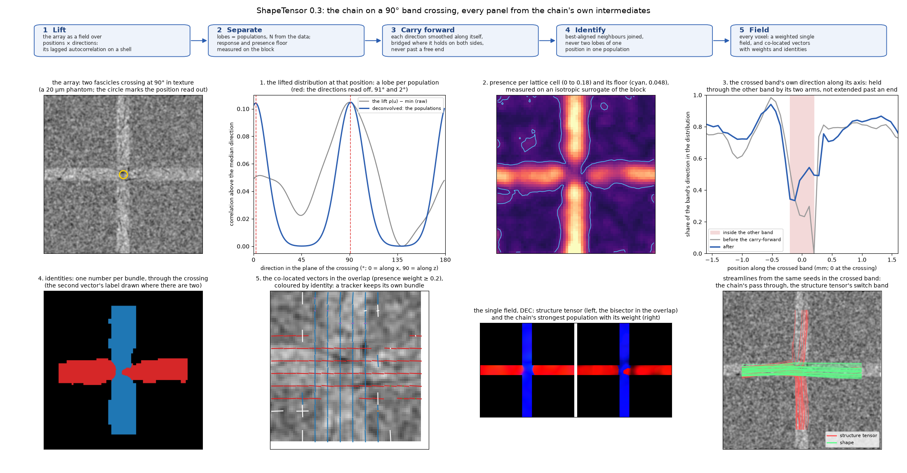

<div align="center">


</div>

# ShapeTensor

Orientation fields of any array — one or several directions per voxel, chosen by the data — on the GPU. A
replacement for the structure tensor where structures cross, bend or end.

The structure tensor holds one axis per voxel: at a crossing it reports the bisector, at a boundary it is dragged
into the plane of the step, past the end of a bundle it keeps going on texture, and it has no memory from one voxel
to the next. A tracker following it switches bundle at every crossing. ShapeTensor is built so that a tracker
arriving at a crossing leaves along the population it came in on, and stops where nothing is present. Five stages,
all classical, nothing trained on the analysed data, one scale parameter:

1. **Lift** — the array becomes a field over positions × directions: its local autocorrelation read on a shell of
   lags. A population of structures along `d` lifts to a lobe at `d`; independent populations add. The structure
   tensor is this field's zero-lag second moment, which can hold one direction; the lifted field holds any number.
2. **Separate** — each position's lobes are its populations, N from the data (0, 1, 2, …), after the single-population
   response (measured on the block itself) is deconvolved. Presence is judged against the block's own null — a
   surrogate with its power spectrum and no anisotropy — and sheets are recognised, never read as crossings.
3. **Carry forward** — each direction's share of the field is smoothed *along that direction* and bridged where it
   holds on both sides, never past a free end: a population continues through a crossing on the evidence of its own
   arms; a bundle that ends is not extended.
4. **Identify** — neighbouring lobes that are each other's best-aligned are joined, best first, under the rule that one
   population never holds two lobes of one position: identities 1, 2, 3, … that follow a bundle through its bends and
   crossings.
5. **Field** — the lifted field is read at every input voxel: a weighted single field everywhere (never cut), and
   co-located vectors with weights and identities where populations coexist.

<div align="center">

</div>

The chain on a 90° band-crossing phantom, every panel from its own intermediates (`scripts/figure_pipeline.py`): the
lifted distribution at a position in the overlap and its two lobes; presence against the floor; the crossed band's
direction carried through the other band by its arms; identities; the co-located vectors; the single field beside the
structure tensor's bisector; and streamlines from the same seeds, passing through in one field and switching band in
the other.

## Install

```bash
git clone https://github.com/Andrew-Keenlyside/ShapeTensor.git && cd ShapeTensor
pip install -e .                   # torch (CUDA), numpy, scipy, zarr >= 3, numba, matplotlib
```

## Use

```python
import shapetensor as st

vec        = st.shapetensor(image, scale=10.0)                                             # (3, Z, Y, X): the strongest direction, (x, y, z)
vecs, w, l = st.shapetensor(image, scale=10.0, multi=True, weights=True, labels=True)      # co-located vectors, weights, identities
vec        = st.structure_tensor(image, rho=10.0)                                          # the excised structure tensor: the baseline
out        = st.orientations(image, scale=10.0)                                            # everything, including the lattice stages
```

```bash
shapetensor run brain.ome.zarr field.zarr --level 0 --scale 10 --chunk 384 384 384 --tissue-threshold 80
shapetensor structure-tensor brain.ome.zarr st.zarr --level 0 --rho 10 --arrays vec gap --float16
shapetensor validate --out validation      # the phantoms and the tracking tests
shapetensor demo                           # a 90° band crossing through the chain, tracked, no data needed
```

`image` is a `(Z, Y, X)` numpy, cupy or torch array (channels `(K, Z, Y, X)` add; `spacing=(dz, dy, dx)` for
anisotropic voxels); the result comes back as the same kind, in the `structure-tensor` package's layout, so the single
field substitutes wherever that is consumed. `scale` is the window in voxels (0.2 mm at 20 µm); the lags, the lattice,
the carry-forward reach and the trusted margin are tied to it. No mask is applied to any output: the weights say where
a population is present. A whole volume is computed chunk by chunk with a halo and one shared null, so it has no
seams; several GPUs split the chunks.

## What the phantoms show

The same deterministic tracker, seeds, step and turning limit on both fields; the texture matched to a real 20 µm
HiP-CT crop (20° of dispersion within a population). Full tables in `docs/validation.md`.

| phantom | measure | shape | structure tensor |
|---|---|---|---|
| band crossing 90° / 60° / 45° | streamlines through the crossing on their own band | 0.89 / 0.86 / 0.89 | 0.06 / 0.42 / 0.40 |
| | switched to the other band | 0.00 / 0.11 / 0.05 | 0.65 / 0.55 / 0.55 |
| T-junction | false continuation past the T | 0.00 | 0.00 |
| a bundle that ends in texture | streamlines continuing past the end | 0.02 | 0.40 |
| intermixed crossing 90° / 60° | streamlines staying within 15° of their population | 0.99 / 0.67–0.91 | 0.10–0.22 / 0.00 |
| bend of radius 0.3 / 0.8 / 1.3 mm | through the 90° turn | 0.39 / 0.92 / 0.99 | 0.92 / 0.85 / 0.99 |
| single populations | direction, median | 2–7° | 3–6° |
| texture | populations found | none | (always one) |

The tightest bend — a turn of 15 voxels inside a 0.2 mm window — is the case the structure tensor still tracks better,
and the remaining open items (identity leakage of 5–15%, the pair at 60° and 45° intermixed crossings not both
resolved to 15°) are listed with their numbers in the validation page. **On real HiP-CT data the lift also reads the
acquisition's own anisotropy** — a population along the rotation axis in most of the white matter beside the in-plane
one, which agrees with the structure tensor where the latter is confident (15° median); an isotropic null cannot
separate it from tissue. `docs/data.md` shows the effect, the tractography (median streamline 3.5 mm, none folded,
against 8 mm to the edge with 8% folded for the structure tensor) and the measured remedies; it is the first open
problem.

## Speed

RTX A6000: about 7 s for a 256³ block (the excised structure tensor 1.4 s); a whole volume in 384³ chunks at
70–100 s per chunk including its 56-voxel halo, several GPUs in parallel. `shapetensor bench` times both on your GPU.

## Layout

```
src/shapetensor/
  __init__.py     shapetensor(), orientations(), structure_tensor()
  lift.py         1. the lift: lattice lags, the null (isotropic surrogate), the response, the deconvolution
  populations.py  2-4. carry-forward (momentum), lobes, sheets, identities
  field.py        Orientations: the chain on a block and the field at every voxel
  volume.py       whole arrays chunk by chunk (no seams), label stitching
  validate.py     the acceptance suite: phantoms, scores, tracking against the structure tensor
  st.py           the structure tensor (plain, excised), eigen, the structure-tensor layout, whole volumes
  phantoms.py     bundle | crossing | interface | bend | band_crossing (T-junction, free end) | texture, with truth
  tracking.py     a deterministic streamline tracker over multi-vector grids
  artefacts.py, viz.py, stats.py, filters.py, cli.py
  pipeline.py, separate.py, tensors.py, merge.py, features/, dev.py, ...   the 0.2 pipeline (anatomix shape features), importable
  archive/        earlier routes
tests/            pytest (CPU)
docs/             mkdocs; docs/archive the 0.2 pages
notes/            the research log, review and plans; TCA_FIELD_RESULTS.md the measurements
```
