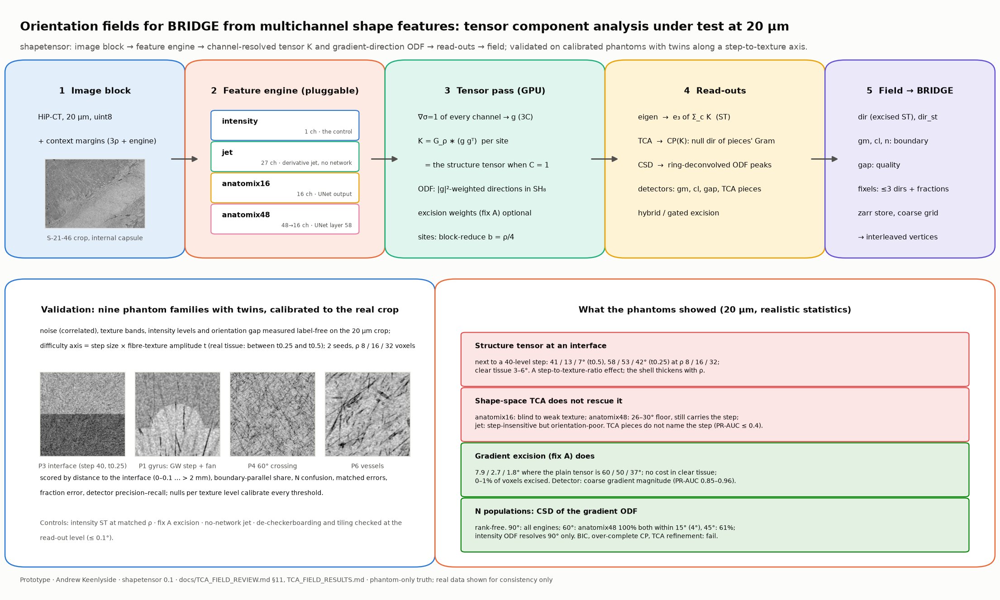

<div align="center">


</div>

# ShapeTensors

Fibre orientation fields for HiP-CT white matter, from multichannel "shape space" features as well as from the
intensity itself, with the boundary problem of the structure tensor and several fibre populations per site in view.
The question it set out to answer: can a tensor built from the gradients of anatomix's shape-space channels, or a
tensor component analysis (TCA, a CP decomposition) of them, ignore the grey/white and tract-interface steps that the
intensity structure tensor mistakes for fibres, and give more than one orientation where fibres cross?

## Summary

**Pipeline.** An image block with context margins goes through a pluggable *feature engine* (the intensity itself;
a locally normalised derivative jet; anatomix's 16-channel output; anatomix's 48-channel layer 58). The gradients of
every channel, integrated over a window ρ, form the channel-resolved tensor `K = G_ρ ∗ (g gᵀ)` (the structure tensor
when there is one channel) and the gradient-direction ODF on a coarse site grid. *Read-outs* turn them into
directions: the eigenvector of the summed tensor; TCA, which fits the unsummed voxel × channel × axis array as pieces
with one direction each and pairs them into populations; constrained spherical deconvolution of the ODF, whose peaks
are the populations; and the excised tensor (fix A), which drops boundary gradients before integrating. The *field*
written for BRIDGE carries the single direction, the boundary strength and normal, a quality measure, and up to three
fixels per site.

**Validation.** Nine phantom families with twins at 20 µm, calibrated label-free to the real S-21-46 crop (noise
spectrum, texture bands, intensity levels, orientation coherence), swept along a step-to-texture-ratio axis and
scored by distance to the interface, with controls (the structure tensor at matched ρ, fix A, the no-network jet).

**What it found.** The boundary failure is a step-to-texture-ratio effect; at 20 µm it appears in weak-texture
white matter next to a strong step. Shape-space TCA does not rescue the orientation there; gradient excision does
(7.9 / 2.7 / 1.8° where the plain tensor is 60 / 50 / 37°, at no cost in clear tissue), with the coarse gradient
magnitude as the boundary detector. For several populations, CSD of the gradient-direction ODF is the rank-free
estimator; the anatomix layer-58 features sharpen it on tight crossings. Orientation does live inside anatomix — in
its second encoder block, which a small phantom-trained head can read per voxel — but the output head removes it.
Details: `docs/TCA_FIELD_REVIEW.md` (§11 for the verdict), `docs/TCA_FIELD_RESULTS.md`.

<div align="center">



</div>

How TCA reads several orientations out of shape-space data: `figures/tca_field/tca_multi_explainer.png`. Why the
shape space cannot be clustered into fibre populations first: `figures/tca_field/shape_space_clusters.png`. Where
orientation is encoded inside anatomix: `figures/tca_field/encoder_tuning.png`.

## The package (2026-10-16): `src/shapetensor/`

The prototypes below were consolidated into an installable package with a pluggable feature engine and both
read-out families, plus a phantom validation suite. **Read `docs/TCA_FIELD_REVIEW.md`** (the review and the
recommended design) and **`docs/TCA_FIELD_PLAN.md`** (what is built and the run order).

```
src/shapetensor/
  filters.py        scipy-identical Gaussian / derivative filters on the GPU (torch)
  features/         engines: intensity | jet (no network) | anatomix16 | anatomix48  (make_engine(name))
  pca.py            per-volume PCA to n_pcs channels
  tensor.py         K = G_rho * (g g^T) on a site grid (k_sites: one row; k_dense: a block); the gradient-direction ODF
  odf.py            real SH basis, Funk-Radon, CSD with a ring response, peaks
  readout/single.py eigen (the structure tensor), TCA rank 3, boundary detectors
  readout/multi.py  CP-ALS, geometric pairing, N by BIC / FRT / CSD + refinement + stability / over-complete grouping
  readout/hybrid.py H1 blend / switch;  tensor.excision_weights(gate=...) is H2
  phantoms/         P1-P9 at any voxel size with twins and truth; stats.py measures real crops to set them
  validate/         suite.py (caches, read-outs, scores), score.py, report.py (REPORT.md + figures)
  field.py          the field store a later BRIDGE reader would sample
  cli.py            shapetensor stats | phantoms | run | report
```

Environment: the `shapetensors` conda env (torch 2.5.1, anatomix); the package is on its path through a `.pth`
file (`src/`). Tests: `python tests/test_core.py` (CPU/GPU parity and recovery), `python tests/test_anatomix.py`
(GPU). Data: `/home/andrew/bridge_wmcov/shapetensor/` (phantoms, caches, results, figures).

The work started inside BRIDGE, as the grey/white boundary-shell problem (`docs/BOUNDARY_PROBLEM.md`). It moved here
on 2026-10-15 to be tested as an approach in its own right. Everything here is a **prototype**.

**For the current recommended pipeline, read `docs/IMAGE_TO_VECTORS.md`** (image to vector field: what to use, the
evidence, the open problems). **For the history, start with `docs/SHAPE_SPACE_HANDOFF.md`.** It holds the status, the results so far, the user's standing
directions, the clean-anatomix recipe and the open threads. The task in progress is at the end of its section 8.

## Layout

- `scripts/`: the study scripts, flat. Each puts its own directory on `sys.path` and imports its siblings.
  - `anatomix_shape.py`: running anatomix cleanly (`anatomix_clean`), PCA/RGB helpers, `_PadTile` for windows under
    32 voxels.
  - `surface_phantoms.py` / `phantom_shell.py`: the phantoms (`python <script> make`).
  - `shape_tensor*.py`, `fibre_select.py`, `shape_separate*.py`, `shape_window.py`: phantom studies.
  - `shape_20um_space.py`, `shape_20um_explain.py`: steps 1 and 2 on the 20 µm S-21-46 crop.
  - `shape_real.py`, `voi_location.py`: the 100 µm S2146 block (needs data not copied here).
  - `tensor_variants.py`, `edge_aware_*.py`, `anat_lib.py`: shared tensor code, phantom figures, and the BRIDGE-side
    helpers (`anat_lib` needs numba; `phantom_shell` and `edge_aware_builds` import `bridge` lazily, only to build
    phantoms with BRIDGE).
- `docs/`: the handoff, the boundary-problem brief, the literature review.
- `figures/`: every figure so far (`shape_tensor/`, `anatomix/`, `edge_aware/`). New figures go here.

## Path mapping from the BRIDGE days

The docs were written inside BRIDGE. Read their paths as:

| in the docs | here |
|---|---|
| `scripts/studies/wm_coverage/bending_wrapping/<x>.py` | `scripts/<x>.py` |
| `scratch/wm_coverage/bending_wrapping/<dir>/` (figures) | `figures/<dir>/` |

Data paths are unchanged and absolute (same user and layout as msm12):
- `/home/andrew/bridge_wmcov/shape_tensor/`: features, scores, the `win/` window cache (float16), JSON results;
- `/home/andrew/bridge_wmcov/edge_aware/phantoms/`, `/home/andrew/bridge_wmcov/phantom_shell/`: the phantoms;
- `/home/andrew/bridge_wmcov/carryover/`: the BRIDGE boundary-problem carry-over (HCP comparison data, old scripts);
- `/hdd/andrew/BRIDGE/atlas20/crops/S-21-46.ome.zarr`: the 20 µm calibration crop; `thresholds.json` beside it;
- `/home/andrew/scripts/scalable-reg`: chunkreg, for `AnatomixFeatures` (put on `sys.path` by `anatomix_shape.py`).

Not here: the 100 µm S2146 OME-Zarr, the BRIDGE study snapshot and HCP-1065 (only `shape_real.py`,
`voi_location.py` and BRIDGE-level work need them), and the SynthSeg label crop path the 20 µm scripts name under
`/hdd/data/...`. On czi001 the source crops, labels included, are at `/hdd/andrew/brain_atlas_20um_test_crops/`;
labels are not in use (standing direction).

## Environment

anatomix work needs torch, anatomix (`pip install git+https://github.com/neel-dey/anatomix.git`), monai, numpy,
scipy, scikit-learn, zarr 3, matplotlib, nibabel, tifffile. On msm12 this was the `chunkreg` conda env (torch 2.5.1,
anatomix 0.1.0, monai 1.5.2; versions in `env_msm12_chunkreg.txt`). Weights come from the HF hub (`neeldey/anatomix`).
czi001 had no env with torch + monai + anatomix at the move.
