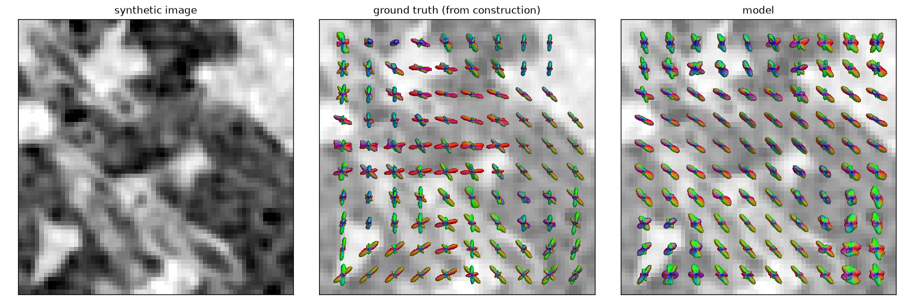

<p align="center"></p>

# ShapeTensor

**Object-level orientation distributions from any intensity volume.**

ShapeTensor maps a 3D image to a shape latent, from which the orientation distribution functions (ODFs) of the
objects present at any point can be read: per object or per group of objects, at the window and grouping level you
choose. It is trained only on synthetic volumes whose orientations are known by construction, with contrast,
resolution and artefacts randomised far beyond any single imaging modality, so it learns shape rather than
appearance.

<p align="center"></p>
<p align="center"><em>A synthetic crop (middle slice), its ground-truth ODFs from construction, and the model's ODFs.
Glyphs are spherical-harmonic ODFs coloured by direction (red x, green y, blue z).</em></p>

## Install

```bash
pip install -e ".[dev,figures]"
pytest -q tests
```

## Use

```bash
# train on synthetic data drawn on the fly
bash scripts/train.sh runs/model 600

# evaluate on held-out synthetic crops and on known-truth phantoms
PYTHONPATH=src python scripts/eval_density_ce.py 24 runs/model/model.pt
PYTHONPATH=src python scripts/eval_phantoms.py runs/model/model.pt
```

## Design

- [Principles](docs/design/principles.md)
- [Model and readout](docs/design/model.md)
- [Synthetic data](docs/design/data.md)
- [Evaluation](docs/design/evaluation.md)

Research code, under active development.

## Licence

MIT
