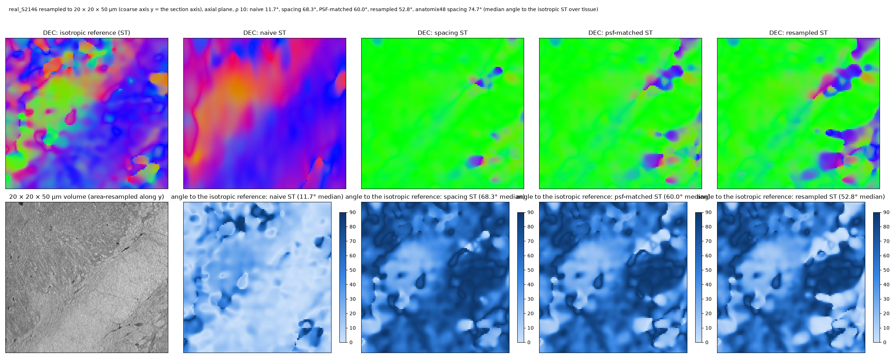

# Non-isotropic data

Section stacks, laminographic and many tomographic protocols sample one axis more coarsely than the other two —
20 × 20 × 50 µm, say. This page says what the package does about it, what that fixes, and what it cannot fix.

## What `spacing` does

Pass the voxel size per axis as `spacing=(dz, dy, dx)` (any units; only the ratios matter):

```python
vec = st.cp.shapetensor(image, rho=10.0, spacing=(2.5, 1, 1))     # 50 x 20 x 20 um, z the coarse axis
```

- `sigma` and `rho` stay in units of the **finest** voxel; along a coarser axis every Gaussian (derivative and
  integration) is shrunk by the ratio, so the filters are the same physical size in every direction;
- each derivative is divided by its axis spacing, so the gradient — and the tensor, its eigenvectors, the ODF and
  the fixels — are in physical coordinates;
- the sampled first-derivative kernel loses its unit first moment below σ ≈ 0.8 voxel (at σ 0.4 it returns half the
  derivative — a property of scipy's kernel too), so it is renormalised there; at the usual σ ≥ 1 nothing changes;
- the shape engines (anatomix) need isotropic voxels, so the block is resampled to the finest-axis grid before the
  network and the tensor is resampled back onto the input grid; the fixels are read on the isotropic grid and
  returned nearest-sampled.

The same option is on `structure_tensor_3d`, `excised_structure_tensor_3d`, `shape_structure_tensor_3d`,
`fixels_3d` and `excision_weights`; `st.to_isotropic` / `st.from_isotropic` are the resampling helpers.

## What it fixes: the geometric bias

Ignoring the spacing tilts every oblique direction towards the coarse axis, because the coarse-axis derivative
is over-estimated by the ratio (a derivative per coarse voxel is 2.5 derivatives per fine voxel). For a fibre at
45° to a 2.5× coarser axis the analytic bias is 23°; the unit test (`tests/test_st.py`) measures 23.1° for the
naive tensor and 1.7° with `spacing`. Whenever the coarse axis still resolves the texture, this is the whole
story and `spacing` is the right estimator.

## What it cannot fix: lost contrast across the fibres

The phantom test (`scripts/bench/anisotropy_test.py`; results log §16) resamples each phantom 2.5× coarser along
one axis by area averaging and reads it back four ways — naive, `spacing`, PSF-matched (the other two axes blurred
to the same resolution, then `spacing`), resampled to isotropic first — for the plain and excised tensors and the
anatomix48 shape tensor, against the truth. Median angle within 0.1 mm · far from the structure, ρ 16, half texture:

| phantom | isotropic plain / excised | coarse axis | naive plain / excised | `spacing` plain / excised | PSF-matched | resampled | anatomix48 naive / `spacing` |
|---|---|---|---|---|---|---|---|
| step 40 | 12.6 / 3.1 · 2.6 | **across** the fibres | 39 / **1.9** · 1.5 | 89 / 88 · 89 | 88 · 87 | 88 · 76 | 41 / 82 · 10 / 76 |
| | | along the fibres | 46 / 34 · 36 | **14 / 20** · 19 | 5.6 · 16 | 3.0 · 16 | 50 / 9.8 · 46 / 16 |
| gyrus | 15.5 / 2.5 · 1.9 | **across** | 37 / **1.7** · 0.9 | 89 / 89 · 87 | 89 · 38 | 89 · 6.0 | 43 / 88 · 3.5 / 79 |
| | | along | 57 / 41 · 31 | **7.2 / 5.4** · 7.3 | 6.2 · 6.5 | 5.2 · 5.2 | 71 / 6.8 · 42 / 5.5 |
| vessel | 14.8 / 3.3 | **across** | 8.9 / **2.5** | 68 / 88 | 55 | 45 | 13 / 64 |
| | | along | 43 / 40 | **17 / 17** | 15 | 14 | 47 / 13 |

Two regimes, decided by the geometry of the coarse axis against the fibres:

- **Coarse axis across the fibres** — the section-stack case, fibres lying in the section plane. Every physically
  consistent reading fails outright: the direction snaps onto the averaged axis (84–89°). The across-fibre texture
  has a period of ~4 voxels (80 µm), at or below the Nyquist limit of 50 µm sampling, so the contrast that
  distinguishes "the fibre runs along this axis" from "this axis was blurred" is aliased away, and the blurred axis
  becomes the axis of least variation. The naive tensor gives 1.7–2.5° with excision — as good as isotropic — only
  because its over-estimated coarse-axis derivative (×2.5, ×6.25 in energy) happens to cancel the blur-and-aliasing
  loss at this texture scale and ratio. It is a coincidence of the numbers, not an estimator, and it fails in the
  other regime.
- **Coarse axis along the fibres**: the physical readings are right (5–20°) and the naive tensor carries the
  geometric bias and more (34–57°), as does naive anatomix48 (42–71°).

The excised and plain tensors track each other throughout; the anatomix48 shape tensor (resampled internally)
behaves like the `spacing` tensor.

## Real data

The same block resampled 2.5× along its section axis and compared with the isotropic structure tensor (no truth;
results log §17): the BigBrain VOI and the HiP-CT crop both behave like the *across* regime — `spacing`,
PSF-matched and resampled readings snap onto the averaged axis (41–68° from the isotropic field), the naive tensor
stays at 12–16°. The isotropic references have orientation gaps of 0.25, i.e. weakly determined directions that
are easy to tip.



## What to do with anisotropic data

1. Sample isotropically at the fibre-texture scale (≤ 25 µm here) whenever the acquisition allows: a 2.5× coarse
   axis destroys the across-fibre contrast for every fibre running perpendicular to it, and no filter recovers it.
2. If the data are anisotropic anyway, use `spacing` **and** treat the directions as unreliable for fibres within
   ~30° of the plane perpendicular to the coarse axis; the orientation gap does not flag this failure (the snapped
   direction can be confident).
3. Do not rely on voxel-unit filtering being "accidentally right": it is right only at one ratio and one texture
   scale, and wrong by 30–60° for fibres with a component along the coarse axis.
4. The open estimator is one that treats the coarse-axis gradient energy as a prior rather than a measurement;
   the package does not have it yet.
