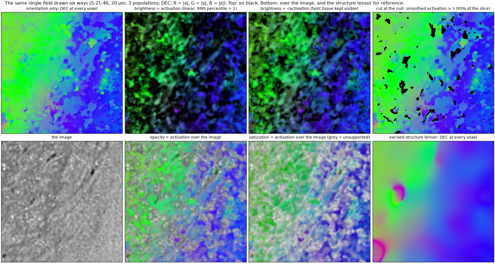

# 4. Merging the population fields

Two outputs, both covering the whole volume, both carrying the activation as weight. **No masks are applied**: a
mask would cut the field where a population fades, and a downstream consumer can weight or threshold as it
needs. Where a population is absent its weight is at the noise level, and the null `tau` exported with every
field says what that level is.

## One vector per voxel

The merged population tensor, each population's tensor weighted by its activation:

$$T = \sum_r a_r\, \frac{S_r}{\operatorname{tr} S_r}$$

Its smallest eigenvector is the field's direction, its gap the uniqueness, the total activation its weight. A
layer without a coherent direction has a near-isotropic tensor and adds none, so it is discounted by itself.
This is the shape tensor's single field — the like-for-like alternative to the structure tensor's eigenvector.

## Several vectors per voxel

Every population's direction at every voxel, ordered by activation, with the activation as weight
(`vecs (N, 3, Z, Y, X)`, `weights (N, Z, Y, X)`). A streamline builder that follows the vector most aligned with its
heading can use the weight as its confidence; where one population is present the others' weights sit at the
noise level.

```python
out = st.population_field(image, rho=10.0)
out["vec"], out["vec_gap"], out["weight"]       # the single field
out["vecs"], out["weights"], out["tau"]         # the multi-vector field and the activation null
```

## Tissue and population masks, for those who want them

For node sampling or display, `tissue_mask` is where the smoothed *total* activation exceeds the null, `masks`
where each population's does, and `strongest` the index of the most active population inside the tissue mask.
They are outputs, not steps: nothing in the vectors depends on them.

## At a chunk seam, and what the weights mean

The chunked driver finds the populations of every chunk, and calibrates every chunk on itself, so the merged tensor
differs from its neighbour's near their common face even though every voxel's tensors are exact; written side by
side, the two readings meet in a visible seam. `run_volume` therefore overlaps neighbouring chunks by `blend`
voxels (32) on each side of every face, accumulates each chunk's merged tensor — it is linear in the activations —
with linear ramps that sum to 1 across the seam, and takes the field from the blended tensor, so one reading turns
into the next over 64 voxels. The network and the filters see enough beyond the overlap for every blended tensor to
be exact. The multi-vector field is written per chunk without blending: it is ordered by activation at every voxel,
so its first vector means the same on both sides of a seam, but the set of populations may not.

The activation weights of `apply` are in the standardised feature's units, normalised per direction; `weight / tau`
is the dimensionless presence (above 1: present). `run_volume` writes the weight already divided by the chunk's
null, so that chunks calibrated on themselves are comparable, and zero where the volume has no data.

## Displaying the field

The field is a direction and a weight at every voxel, and how it is drawn is a choice made at display time, not in
the pipeline. The figures in this documentation draw every direction field as plain DEC colour (R = |x|, G = |y|,
B = |z|) at every voxel, the shape tensor's exactly as the structure tensor's, and show the activation as its own
layers; the same field can also be drawn with the activation as brightness (linear or compressed), cut at the null,
or over the grey image with the activation as opacity or as saturation (`shapetensor.viz.dec_rgb`,
`dec_activation_overlay`; `scripts/renderings.py`, which redraws from a cached slice without the GPU):



- **Orientation alone** shows what the vectors say everywhere, including where nothing oriented is present; it is
  the honest comparison with the structure tensor's DEC, which also has a direction at every voxel.
- **Brightness = activation** is the field as a downstream consumer should weight it; the square root keeps the
  faint tissue readable when the scale is set by the strongest fascicles.
- **Cut at the null** is the tissue mask as a display; it is the one rendering that hides information.
- **Over the image**, opacity shows where the orientation is supported and what it is supported by; saturation keeps
  the image's anatomy legible and greys out the unsupported voxels.

## Following the field

`shapetensor.tracking.track` is a deterministic streamline tracker over a multi-vector grid (nearest-vector,
curvature-limited), the same code for every field, so that fields can be compared by their streamlines rather than
by their vectors. Given the no-mask field's `weights` and a `min_weight` (the null `tau`), it follows a vector only
where its population is present. [Real data](../data.md) shows the structure tensor's and the shape tensor's streamlines on the
same HiP-CT block.
