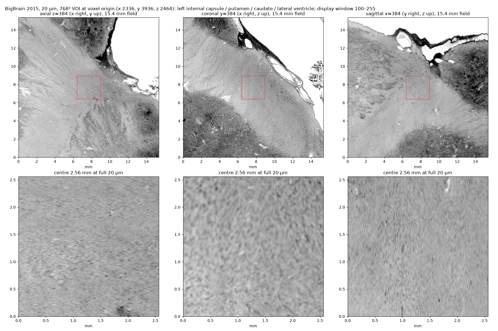
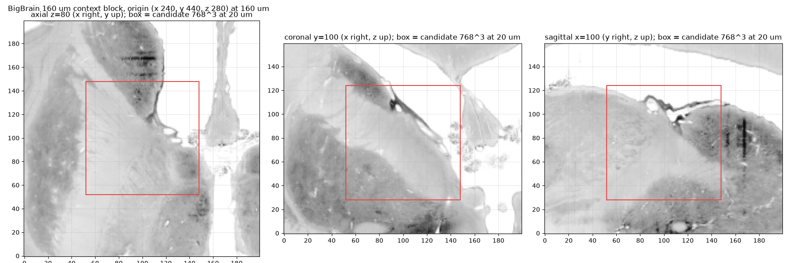
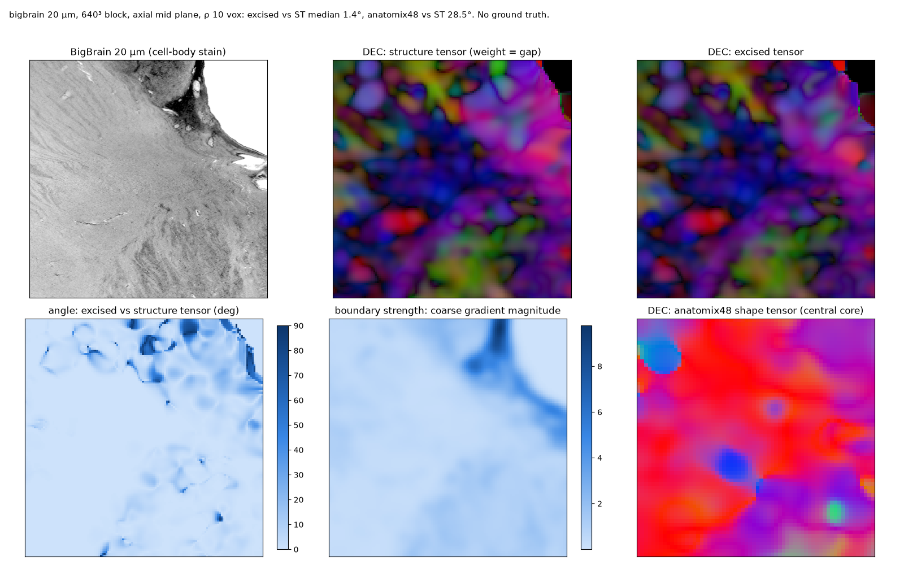
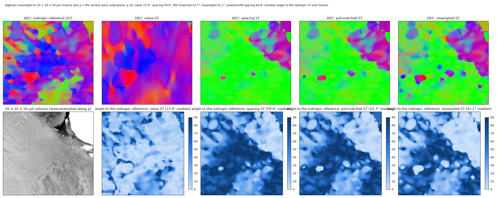

# BigBrain

The BigBrain (Amunts et al. 2013; Jülich / McGill) is a 20 µm isotropic reconstruction of one human brain from
7,404 coronal histological sections. It is the only public whole-brain histology at the HiP-CT scale, and so the
natural second real-data test for the package — with one caveat that decides what it can test.

## One stain

BigBrain is a **Merker silver stain for cell bodies**: grey matter dark (cell bodies), white matter pale, background
and CSF white (255). There is no myelin or other fibre stain of the same brain; the only other registered modality
in the release is an ex vivo MRI at 0.444 mm. BigBrain2 (a second brain, pre-release) is the same stain. Jülich's
other architectonic modalities — myelin-stained and receptor-autoradiography sections, 3D-PLI fibre orientation —
exist as adjacent 2-D sections of other brains, not as volumes registered to BigBrain. So BigBrain tests the
pipeline on a cell stain's white matter (fibre bundles visible through the rows of glia and the pencil fibres),
not on a fibre stain, and a two-stain experiment on it is not possible.

## Access

The 2015 release is served as a neuroglancer precomputed store (uint8, 64³ raw chunks, scales from 20 µm to
1.28 mm): `https://neuroglancer.humanbrainproject.eu/precomputed/BigBrainRelease.2015/8bit`. The array axes are
x = left–right, y = posterior → anterior (the section axis, 20 µm), z = inferior → superior; in-plane voxels are
21.17 µm. `scripts/bigbrain_fetch.py` pulls any block of any scale with the standard library only:

```bash
python scripts/bigbrain_fetch.py 640um 0 206 0 232 0 179 whole_640um.npy        # locate a region at 640 um
python scripts/bigbrain_fetch.py 20um 2336 3104 3936 4704 2464 3232 voi.npy     # a 768^3 block at 20 um, ~100 s
```

The array is written in `(z, y, x)` order. The `classif` store beside it is a grey/white segmentation at 200 µm.

## The VOI

A 768³ block (15.4 mm) at voxel origin (x 2336, y 3936, z 2464) in the 20 µm grid: the left internal capsule with
the putamen and caudate (dark nuclei crossed by the pencil-fibre striations), the lateral-ventricle wall at one
corner, a second nucleus at the opposite corner — three boundary types in one block, chosen to mirror the HiP-CT
S-21-46 crop.





Intensities: 19% of voxels ≥ 250 (CSF and background), tissue mode at 209, tissue 10 / 50 / 90 percentiles
153 / 198 / 219. The same texture profile as on the HiP-CT crop (`phantoms.stats.profile`, central 256³):

| | BigBrain white matter | HiP-CT S-21-46 |
|---|---|---|
| noise SD | 4.3 | 10.8 |
| DoG texture RMS at 1–2 / 2–4 / 4–8 / 8–16 voxels | 2.0 / 2.1 / 2.4 / 2.5 | 4.1 / 3.1 / 2.4 / 2.3 |
| gradient energy at σ 1 | 14 | 67 |

Half the fine-scale texture, a quarter of the noise, and grey/white and white/CSF steps of 40–50 levels: a
step-to-texture ratio about twice the HiP-CT crop's, i.e. the regime of the half-texture phantoms where the plain
tensor gives 41 / 13 / 7° at a step and the excision 5 / 3 / 2°.

The caveat visible in the insets: in the axial and sagittal planes (cutting across sections) the fine grain is
partly section-to-section striping along y; the coronal (in-section) inset shows the histology. The structure
tensor locks onto that striping wherever the tissue texture is weaker.

## The fields on it

`scripts/demo_bigbrain.py --rho 10` (and `--rho 16`): the structure tensor, the excised tensor and the anatomix48
shape tensor at 20 µm, on a 640³ block (shape tensor on a 256³ core).



- The structure-tensor field is a mottled patchwork rather than coherent bundles: orientation gap 0.26 at ρ 10 and
  0.25 at ρ 16, with much of the block's direction set by the striping rather than by fibres.
- Excision changes the direction by 1.4° (ρ 10) / 2.4° (ρ 16) median over tissue, and by 12° in the top decile of
  boundary strength — the CSF and grey-matter steps are strong in a cell stain, and the vessel and ventricle walls
  are where the plain tensor is corrected.
- The anatomix48 shape tensor is coherent and 25–29° away from the structure tensor (7–8° near boundaries, 30–32°
  in texture): on the cell stain, as on HiP-CT, the shape features do not read the fibre texture the tensor reads.

## Anisotropy on it

The block resampled to 20 × 20 × 50 µm along the section axis (`--rho 10`, results log §17): the physically correct
readings (`spacing`, PSF-matched, resampled) land 41–62° from the isotropic field, the naive tensor at 15–16° —
the *across-the-fibres* regime of the [non-isotropic data](anisotropy.md) page, and the section-axis striping is
what gets averaged away.



## What BigBrain is good for here

A real-data check that the pipeline runs on a second modality with inverted contrast and strong CSF steps (it does:
same excision behaviour, same shape-tensor disagreement, consistent anisotropy regime); a texture profile that
places a cell stain on the phantom's difficulty axis; and the pencil-fibre and ventricle-wall geometry for the
glyph figures. It is not a fibre-orientation ground truth — for that the phantoms, and for a real reference the
3D-PLI sections, remain the sources.
