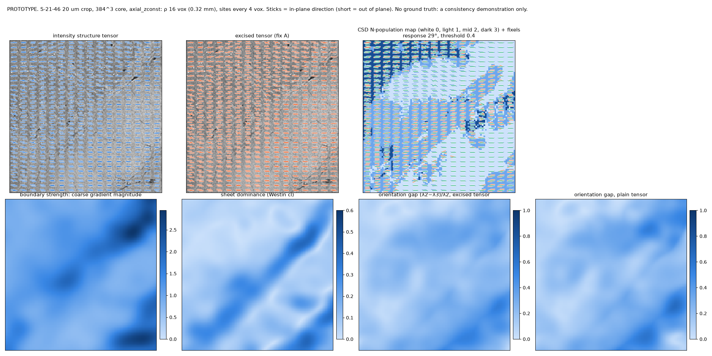
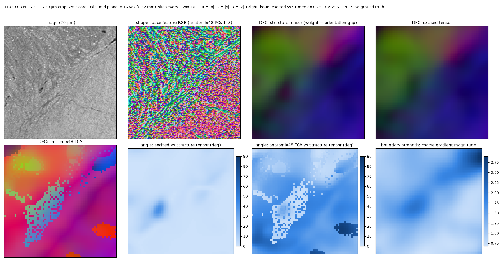

# Brain image data

ShapeTensor was developed for **hierarchical phase-contrast X-ray tomography (HiP-CT)** of whole human brains and
their zooms, but applies to any 3-D volume in which fibre bundles leave a texture: micro-CT, light-sheet, histology
stacks, high-field MRI.

## HiP-CT white matter

- **Resolutions.** Whole-brain overviews at 20–25 µm per voxel; local zooms at 10, 6, 2.5 µm. The parameters of
  every method here are in voxels: the derivative scale σ (1 voxel), the window ρ (8 / 16 / 32 voxels = 0.16 / 0.32 /
  0.64 mm at 20 µm), the margins. Compare scales across resolutions at a fixed window in millimetres.
- **Contrast.** Brains are dehydrated to 70% ethanol before imaging; myelinated white matter is then *bright*, grey
  matter darker, so the grey/white boundary is a strong step at any voxel size (about 38 grey levels between
  white-matter-like and thalamic tissue in the 20 µm crop used here, on a 0–255 scale). Fibre texture darkens the
  tissue locally.
- **Noise.** Phase retrieval low-passes the noise: it is **correlated**, with a residual of about 11 grey levels
  and band energies 3.9 / 2.1 / 1.1 / 0.8 at 1–2 / 2–4 / 4–8 / 8–16 voxels. Treat it as such when you simulate.
- **Texture.** At 20 µm fascicle texture is resolved: band energies (noise removed) of 4.2 / 2.9 / 2.1 / 2.1 over
  bright tissue, with a median orientation gap \((\lambda_2 - \lambda_3)/\lambda_2\) of 0.25–0.30 and 5.8% of sites
  sheet-dominated (Westin \(c_l > 0.3\)) — the tissue is less coherent and more interface-rich than a clean fibre
  model. At 100 µm the texture is largely averaged away and the step remains, which is why the boundary shell is a
  far larger problem in coarse overviews than in zooms.
- **What the orientation methods need.** Fibre texture resolved by the derivative scale, enough of it inside the
  window, and interfaces that are either excised or no larger than the texture energy. The validation's texture axis
  (t = 1 … 0.1) spans from textured deep white matter to the smooth core of a large tract; the real crop's median
  sits between t0.25 and t0.5.

## Measuring your data

`shapetensor.phantoms.stats.profile(volume, mask)` returns, label-free, the noise band energies (from the smoothest
blocks), the texture bands with the noise removed, the intensity modes, and `real_cl.py` in `scripts/bench/` the
orientation-gap and sheet-dominance distributions of the structure tensor at several ρ. Run them on a representative
crop before choosing ρ and before trusting a texture-dependent result; they are what the phantoms are matched to.

## Running on a volume

### A block

Read a block with context on every face — `truncate * (sigma + rho)` voxels for the filters (64 at σ 1, ρ 16,
truncate 4), plus 64 for the anatomix engines — and crop the result back:

```python
from shapetensor import np as st
vec = st.shapetensor(block, sigma=1.0, rho=16.0)[:, m:-m, m:-m, m:-m]
```

### A whole OME-Zarr

```bash
shapetensor volume brain_20um.ome.zarr --level 0 out.zarr --rho 16 --outputs S eig excised fixels \
    --chunk 256 256 256 --rank 0 --world 4
```

Chunks are read with halos sized to the filters, so every chunk's output equals a one-pass computation; several
processes split the chunk list (`--rank` / `--world`), one per GPU. On an H100 node, a 256³ chunk of the intensity
tensor plus its eigen decomposition and the excised version takes seconds; the fixels (an order-8 spherical-harmonic
projection and a batched CSD) a few seconds more; the anatomix engines about 1.5 s per 384³ padded tile per grid
phase. A whole 20 µm hemisphere (~3 × 10¹⁰ masked voxels) is hours on one card for the shape engines and under an
hour on an 8-GPU node; the intensity-only outputs are far cheaper.

### Outputs

The zarr group holds `S` and `S_excised` `(6, Z, Y, X)` in the `structure-tensor` package's layout, `val` and
`vec` / `vec_excised` `(3, Z, Y, X)` (eigenvalues descending; the smallest eigenvalue's vector, components x, y, z),
and `dirs (3, 3, Z, Y, X)`, `fracs (3, Z, Y, X)`, `npop (Z, Y, X)` for the fixels. For a tractography pipeline that
samples an orientation field at vertices, `shapetensor.field.compute_field` writes the compact site-grid store
(direction, boundary strength and normal, sheet dominance, quality, fixels) described in the [quick start](quickstart.md).

## Interpreting the field

- Use `vec_excised` (or `shapetensor(..., excise=True)`, the default) as the single direction; it equals the plain
  tensor away from interfaces and removes the shell at them.
- Treat the orientation gap \((\lambda_2 - \lambda_3)/\lambda_2\) as the reliability of that direction, and Westin's
  \(c_l\) as the flag for "a sheet dominates this window".
- Where `npop` is 2 or 3, the fixels give the populations with their fractions; their thresholds are null-calibrated
  on single-population phantoms at the matching texture level (0.3 of the maximum at full texture, 0.4–0.5 at half),
  and the directions at the real texture level are good to about 15°.
- Real-tissue outputs are consistency demonstrations: no ground truth exists at this scale, and every accuracy claim
  in these pages rests on the phantoms. `scripts/demo_real_crop.py` renders the field on the 20 µm crop for a visual
  check (glyphs over the image, the boundary strength, the N-population map).

## Two demonstrations on the S-21-46 crop (no ground truth)

`scripts/demo_real_crop.py` (384³ core, ρ 16, sites every 4 voxels; CSD response 29°, threshold 0.4 — the null
calibration at the crop's texture level) and `scripts/demo_real_dec.py` (256³ core: direction-encoded colour of the
structure tensor, the excised tensor and the anatomix48 TCA direction, the shape-space feature RGB and the angular
differences):





What they show, and what to read with care:

- **Excision changes the direction only at boundaries.** Against the plain tensor, the excised direction differs by
  0.7° (median over bright tissue), 2.4% of sites by more than 30°; 0.6° where the coarse gradient is weak and 3.3°
  in its top decile, with the largest changes on the dark vessel. Exactly the phantom behaviour (nothing lost in clear
  tissue; the halo removed), at 6% extra cost.
- **The anatomix48 TCA direction is not the fibre direction here.** It differs from the structure tensor by 34°
  (median; 60% of sites > 30°) in patches of one colour with sharp edges, and reports an orientation gap of 0.82
  against the tensor's 0.23 — confident and wrong, as on the phantoms: at this resolution the layer-58 features
  carry texture phase, not fibre orientation, and the CP fit lands in one of a few local minima per neighbourhood.
  The feature RGB (first three PCs) shows the same: structure at the texture scale, with the bundles and vessels
  visible as streaks, not as uniform regions.
- **The N-population map over-reads sheets.** With the null-calibrated threshold the CSD still reports two
  populations at 37% and three at 16% of sites, concentrated on the laminar bundles (top left) and the boundary band
  where `cl` is high. A sheet gives the gradient-direction ODF a single peak, which the ring deconvolution turns into
  a ring of fibre directions — several peaks. Fixels therefore need a sheet gate (`cl`, and the boundary strength)
  before they go into tractography; the sheet-null test on the laminar, gyrus, step and vessel phantoms (results log
  §13) measures the false rate and what the gate removes.
