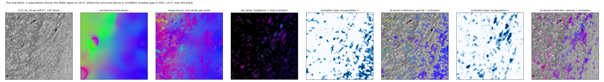
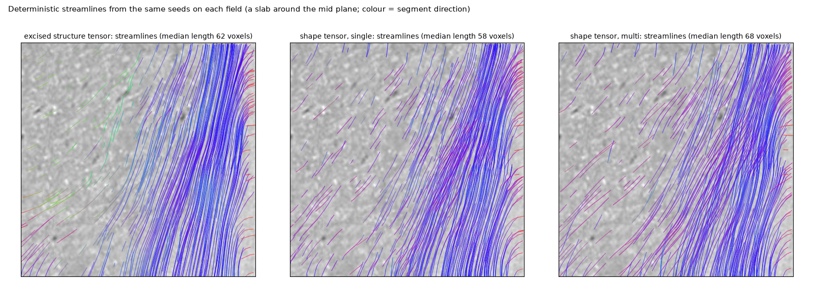
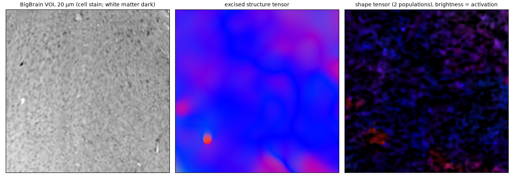

# Real data

Two volumes are used throughout: a HiP-CT crop of human white matter at 20 µm, and a BigBrain volume of interest
at 20 µm. On real data there is no truth; what is shown is the agreement between the fields, their behaviour at
the structures the phantoms model (interfaces, crossings), and the streamlines they give.

## HiP-CT (S-21-46, 20 µm)

A 768³ crop of a dehydrated human brain imaged by hierarchical phase-contrast tomography: white matter is bright,
fibres darken it, the grey/white boundary and vessels are steps of 40–70 grey levels. The phantoms' texture
(fibre density, widths, darkening, noise, dispersion) is matched to this crop (`shapetensor stats`).

The block's own structure tensor is the pipeline's teacher: calibrated on a 384³ block, the readout covers 22 of
24 orientation bins. The shape tensor's single field and the excised structure tensor agree where the tensor is
confident (the top quarter by gap) and in the one coherent bundle the block holds; across the whole block, which is
low-coherence tissue (median gap 0.2), the two fields differ by tens of degrees at the median — the activation
weights are what tells a consumer which voxels to trust.

## BigBrain (20 µm)

A 768³ volume of interest from the BigBrain histological reconstruction (a cell-body stain), resampled to 20 µm:
white matter is dark and nearly featureless at this stain, so it is the harder case for any gradient-based
estimate and a test of the engine on a different contrast. `scripts/bigbrain_fetch.py` downloads it.

## Anisotropic voxels

Both the structure tensor and the pipeline take `spacing=(dz, dy, dx)`; the shape engine resamples the block to
isotropic voxels internally. On 20 × 20 × 50 µm data, fibres that run perpendicular to the coarse axis lose their
across-fibre contrast in the sampling itself, and no filtering recovers it; sample isotropically at the texture
scale where you can.
