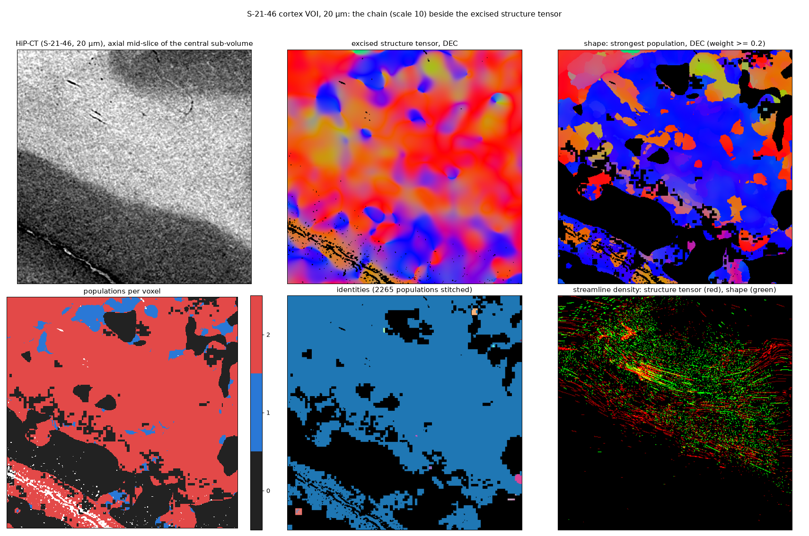

# Real data

A 768³ crop of a dehydrated human brain imaged by HiP-CT at 20 µm (S-21-46, cortex and the white matter under it),
run as a whole volume (`scripts/voi_cortex.py`: `run_volume` in 384³ chunks with the release defaults, labels
stitched, the excised structure tensor beside it, 20 000 streamlines from the same white-matter seeds in both fields
in the central 384³). There is no truth on real data; what is shown is the two fields side by side, what each tracks,
and where they disagree.

## What the chain finds, and what it reads that is not tissue

The structure tensor's field (top middle) runs in the plane of the slices, mostly along x, with the fascicles of the
white matter visible as its texture. The chain finds **two populations in 83% of the white matter**: one in the plane,
agreeing with the structure tensor where the structure tensor is confident (14.7° median at its top 30% of voxels by
orientation gap, 50% within 15°), and one **along z, the tomographic rotation axis**, which is the stronger of the two
at most voxels (top right). The structure tensor has 5% of its directions near z.

The z population is the acquisition, not the tissue. Structure that is constant across slices — the point-spread
function of the reconstruction along the axis, ring arcs, slice-wise intensity — correlates along z at every lag, and
where the tissue's own correlation is weak it is the strongest thing there. The lift reads it where the structure
tensor does not because the structure tensor's σ = 1 derivatives are a band-pass at the texture scale and read the
local gradient, not the correlation at a lag of 2–4 voxels. Measured on a 256³ block against the confident structure
tensor (median angle / share within 15° / share of white-matter first lobes near z):

| lift | agreement | near z |
|---|---|---|
| the interpolated lag ODF of the results log §34 (trilinear shifts) | 18.8° / 0.40 | 0.40 |
| the first build (integer lags 2.5–6.5, high-pass 3) | 48.7° / 0.20 | 0.64 |
| **this release** (integer lags 2–4.5) | **14.7° / 0.50** | 0.64 |
| the same with the acquisition null (`acquisition_null=True`) | 20.1° / 0.39 | 0.41 |
| a spectrum null (`null="spectrum"`) | 78° — the real orientation removed too | 0.00 |

An isotropic surrogate cannot measure the acquisition's anisotropy: it has none by construction. The acquisition null
— the mean lift of the positions below the presence floor, which the null itself calls structure-free — halves the z
share but drops much of the white matter below the floor, because much of its measured presence *was* the acquisition.
A surrogate with the block's full spectrum removes the z population entirely, together with the block's dominant real
orientation. This is the first open problem of the release: a null for the acquisition that leaves tissue alone — from
a structure-free region of the same scan, from the highest frequency band, or as the median directional profile over
many regions of a volume, where fibre directions average out and the acquisition does not.

## Tracking

| | chain | structure tensor |
|---|---|---|
| streamline length, median / p90 | 3.5 / 7.7 mm | 8.2 / 8.9 mm (the sub-volume's extent) |
| at least 1 mm | 0.82 | 0.99 |
| folded (ends closer than half the length, of those ≥ 1 mm) | 0.00 | 0.08 |
| steps taken on the second vector | 0.28 | — |
| stopped where no vector is present | 0.30 | — |

The chain's streamlines follow the in-plane population where it is the second vector (28% of their steps), and stop
where the field has nothing above the floor; the structure tensor's run to the edge of the sub-volume on any texture,
and 8% of them fold back on themselves. The streamline densities (bottom right) agree on the fascicles of the white
matter and differ where the structure tensor continues through the low-contrast tissue.

## Speed on this volume

The chain on the 768³ volume: 8 chunks of 384³ (496³ with the halo), 62–81 s each on an RTX A6000 shared with a
second job, 11 min in all, 1.5 min to stitch the labels; the excised structure tensor 55 s. Memory stayed under 30 GB.
