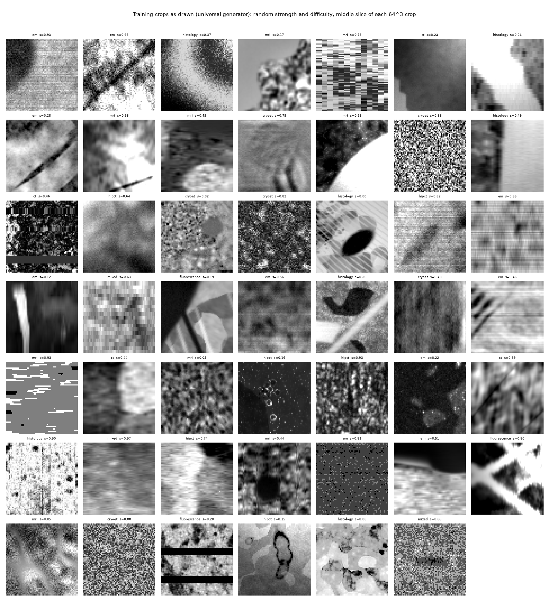

# Synthetic data

Training volumes are generated on the fly, and every crop comes with its geometry. The aim is breadth: as many shapes,
contrasts and corruptions as possible, so that no single appearance is reliable and only geometry generalises.

<em>Training crops as drawn (middle slice of each 64³ crop).</em>

## Geometry

- **Line-like structures:** bundles, fascicles, branching trees, networks, helices, tubules and fibres. Crossings,
  kissing and fanning configurations are included.
- **Sheet-like and cellular structures:** sheets, layered plywood, foams, porous media, honeycombs, lattices, cells,
  nuclei, granules and crystals.
- **Oriented texture fields:** dense, multi-scale strands following smooth orientation fields. Fields are often
  superposed (crossings) or change sharply across a boundary. They are frequently faint under other structures, so
  orientation is a statistical property of the texture rather than of separable objects.
- **Compositional populations:** random combinations of the above. These make up about half of all draws.
- **A construction tree,** from scene to populations, groups and objects, with a size and kind for every node. It
  defines the grouping levels.

## Deformation

The geometry is deformed before rendering, so the targets follow exactly. The deformations are random affine
transforms (scale, shear up to 0.3, bulk shift), smooth and fine non-linear warps, twists and bends.

## Contrast and imaging

- **Random contrast per object,** with random textures (domain randomisation).
- **Physics-based renderers as random alternatives:** X-ray phase contrast, CT, electron microscopy, MRI, light
  microscopy and others.
- **Corruptions, scaled by a random strength:**
  - blur and anisotropic resolution loss;
  - white and correlated noise;
  - bias fields;
  - CT effects: rings, streaks, beam hardening, scatter;
  - ultrasound and OCT speckle;
  - motion and per-slice motion;
  - missing lines and sections;
  - posterisation, clipping and contrast inversion.

The list of modalities and artefacts is a means of covering many kinds of corruption, not a closed set. It keeps
growing.

## Targets

Every object carries its own elliptical ODF from construction:

- a fibre: a line along its tangent, widened by its own spread angle;
- a solid object: isotropic;
- a vessel wall: a sheet around the vessel's axis;
- a region boundary: a sheet along the boundary.

For a query at a point with window *w*, each population's target is the mass-weighted mean of its objects' ellipses
inside a Gaussian window of width *w*, with its share of the window's material; the isotropic background is a share
of its own. Objects too thin to resolve at that window merge into their parent. The targets are verified against the
construction (true fibre centrelines) and against what the clean image shows. No visibility, presence or
classical-reader terms enter the targets.

## Optional shape library

The generator can also draw neuron morphologies and cortical surfaces from an external shape library, which is not
included. Set `SHAPETENSOR_SHAPES` to its location. Without it, those families are simply not drawn.
