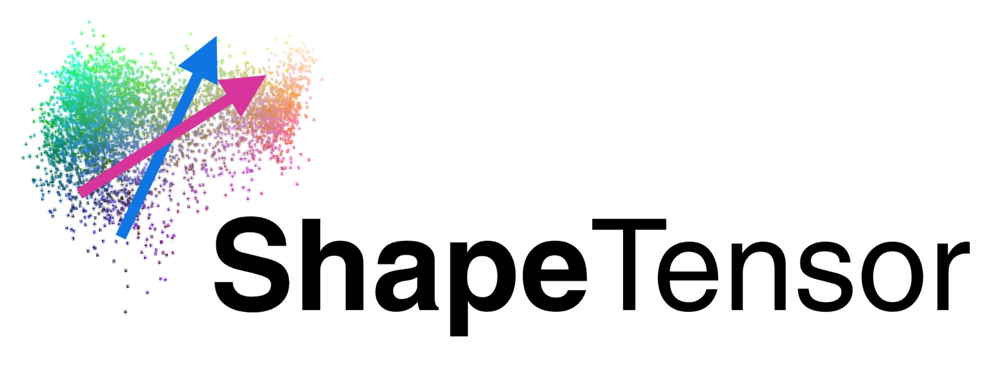
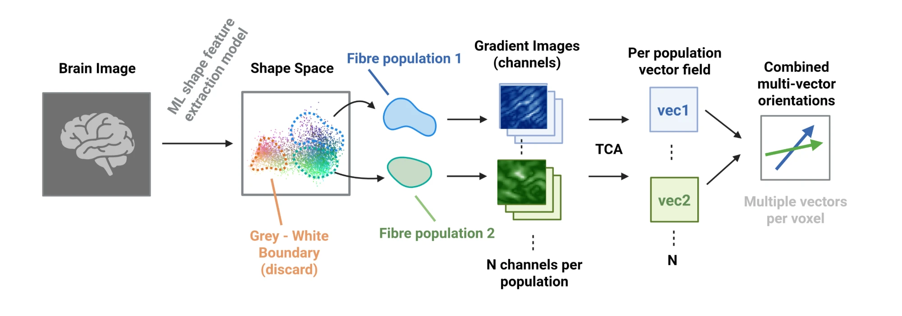

# ShapeTensor

{ width="40%" }

**Fibre orientation fields of high-resolution white-matter volumes, from a pretrained shape-feature space, on the
GPU.**

Tractography on microscopy-scale volumes (hierarchical phase-contrast X-ray tomography, HiP-CT, at 20 µm; serial
histology; light-sheet) starts from a local orientation at every voxel. The standard estimate is the **structure
tensor**: the direction of least gradient energy in a window. It is accurate and cheap, and it has two systematic
failures that go straight into streamlines: at a **tissue interface** the gradients of the step overwhelm those of
the fibre texture and the direction is dragged into the plane of the boundary; where **bundles cross** a single
tensor can only report the bisector.

ShapeTensor replaces the intensity with a pretrained 3-D network's shape features and runs one pipeline:

1. **Shape features** — a contrast-agnostic 3-D UNet (anatomix), read at the encoder layer whose channels encode
   fibre orientation.
2. **Separating populations in the shape space** — the orientation code is read without labels (the structure
   tensor at confident sites is the teacher), the populations present are the modes of the window's orientation
   distribution, and every voxel is unmixed onto their signatures: one **activation layer per population**, a
   full-volume image of that population's shape.
3. **One tensor per population** — the structure tensor of each layer.
4. **Merging** — one vector per voxel from the merged population tensors, or every population's vector with its
   activation as weight. No masks: the weights say where a population is present.

```python
import shapetensor as st
vec  = st.shapetensor(image, rho=10.0)                 # (3, Z, Y, X): one direction per voxel
vecs = st.shapetensor(image, rho=10.0, multi=True)     # (N, 3, Z, Y, X): every population, ordered by activation
vec  = st.structure_tensor(image, rho=10.0)            # the excised structure tensor: the baseline
```

The structure tensor it is compared with runs at the **same σ and ρ** as every tensor in the pipeline, and the
boundary-robust (*excised*) structure tensor is the package's baseline and the pipeline's teacher.



Read [the pipeline](pipeline/index.md) for each stage, [validation](validation.md) for what the phantoms show, and
[real data](data.md) for HiP-CT and BigBrain.

!!! note "Status"
    Version 0.2. The research notes behind every design decision, with all the numbers, are in the repository's
    `notes/` directory; the documentation keeps to what the package does and what has been verified.
