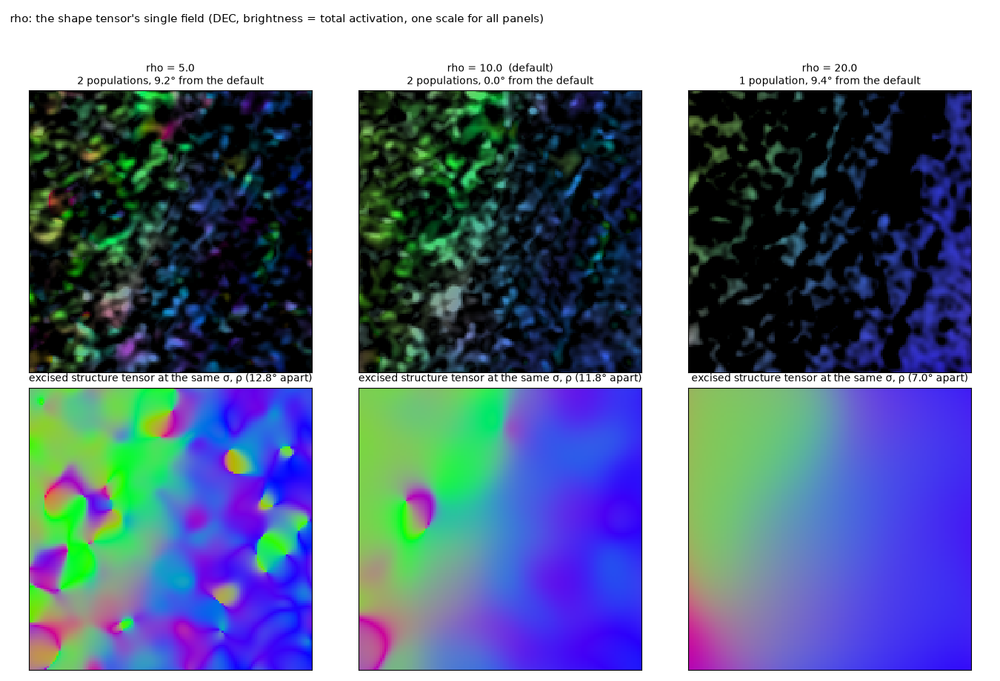
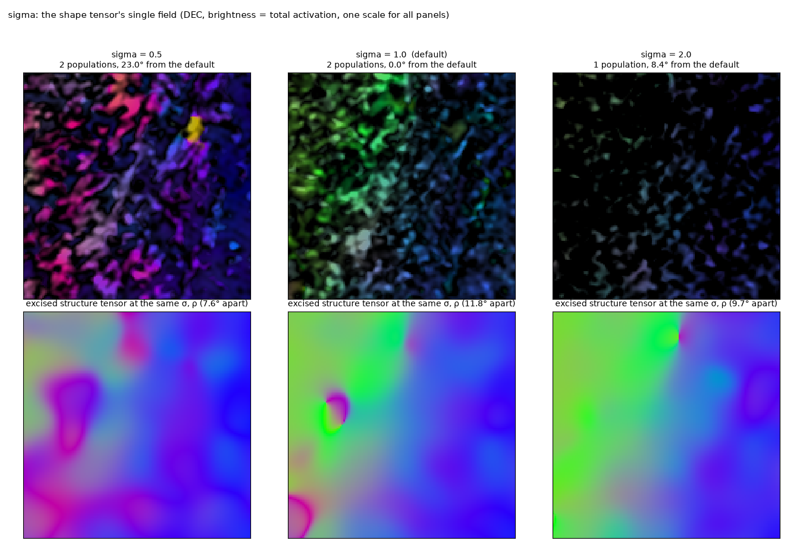
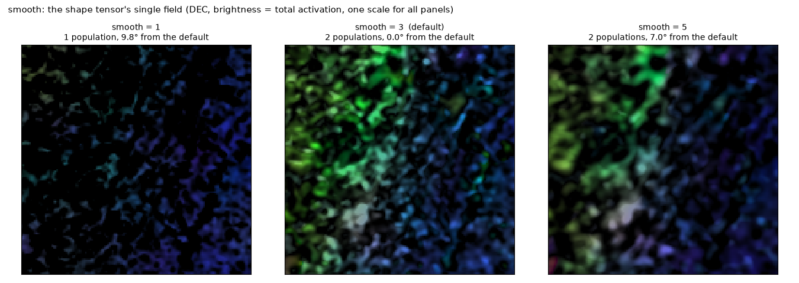
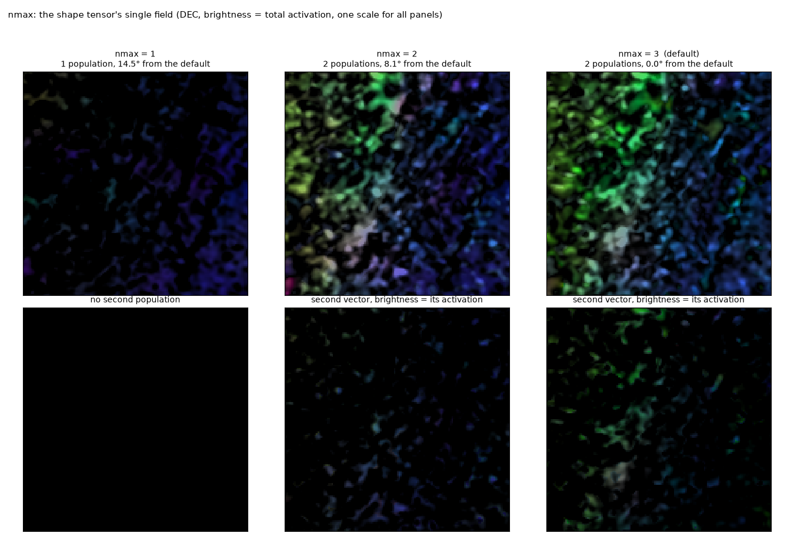
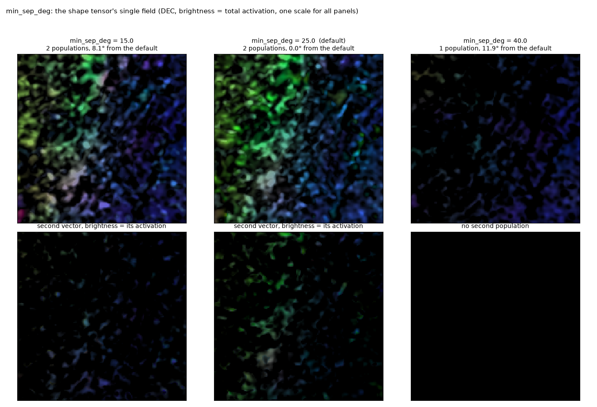
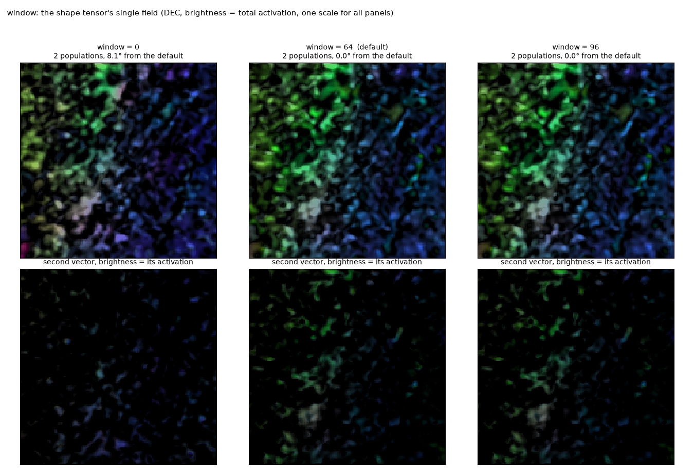
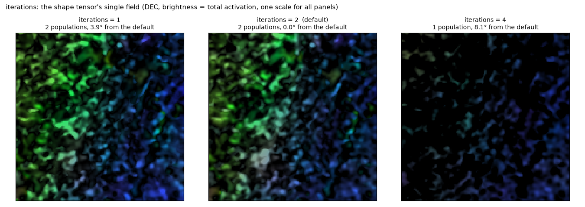
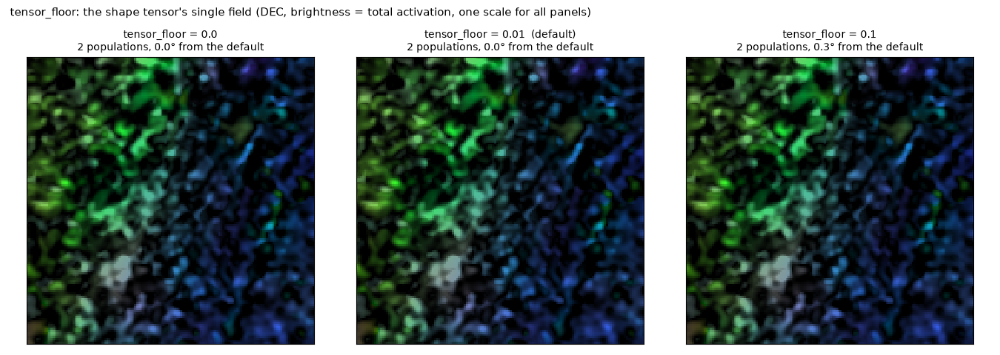
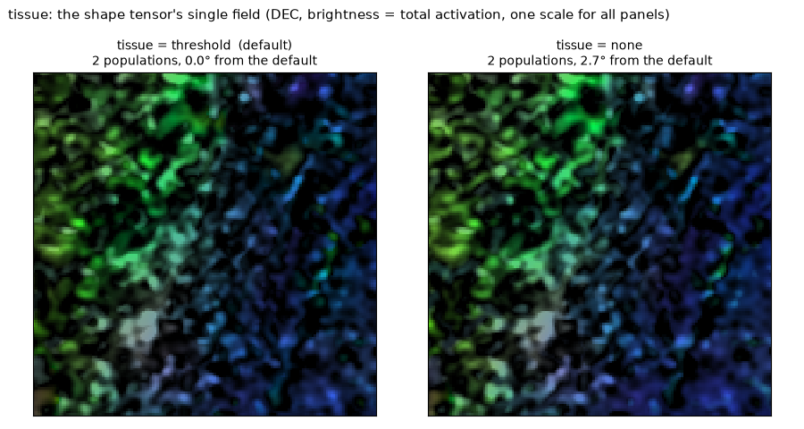

# Parameters

What each parameter does to the field, one at a time, on the HiP-CT block of [real data](data.md) (S-21-46, 20 µm,
a 192³ block calibrated on the 384³ around it), the rest at their defaults. Every strip shows the shape tensor's
single field as DEC colour (R = |x|, G = |y|, B = |z|) with brightness = total activation, on one brightness scale
for every panel: a dimmer panel is lower activation, not a different display. The total activation is the sum over
the populations found, so a run that finds one population where the default finds two is dimmer throughout. The
titles give the populations found and the median angle of the field from the default run's over the tissue.

```bash
python scripts/parameters.py                # docs/img/params_<name>.png, results/parameters.json
```

Two things are *not* parameters: the feature layer (encoder block 2 of anatomix, the layer where orientation is a
linear code) and the teacher (the excised structure tensor at the output `rho`). Changing the scale at which the
shape is read means resampling the image; see [the pipeline](pipeline/index.md).

What the strips show overall: the field's *direction* is set by the scales and by which populations are found, and
by nothing else. The weight floor, the tissue mask and the sub-window size leave it unchanged; a different
population count moves it by 8–15° at the median on this low-coherence block, where the two candidate pairs of
populations are both plausible readings of the tissue.

## The scales: `rho` and `sigma`

`rho` is the integration window of every tensor: the teacher, each population's tensor and the baseline structure
tensor. It is the one scale a user should normally touch. Smaller windows follow the fibres more closely and carry
more noise (the structure tensor's swirl defects at ρ 5); larger ones smooth the field and blur crossings and bends
further. The bottom row is the excised structure tensor at the same `rho`: the two fields move together, which is
what makes the comparison like for like. At ρ 20 the teacher is smoother than the fascicles of this block and one
population is found.



`sigma` is the derivative scale. At half a voxel the gradients see the noise and the teacher, and so the field,
change character (23° from the default); at two voxels the fibre texture (period about 5 voxels at 20 µm) is
blurred before it is differentiated, every tensor loses contrast and one population is found.



## The feature average: `smooth`

The features are box-averaged over `smooth`³ voxels before the readers are fitted and before the activations are
thresholded for the tissue mask. The activation of a rectified filter oscillates with the phase of the fibre
texture; a 3³ average (the default) integrates it. Without it the activations spike voxel by voxel, the null is
lower and the second population is not confirmed; a 5³ box blurs the layers at the scale of the box and leaves the
field within 7° of the default.



## Finding the populations: `nmax`, `min_sep_deg`, `window`, `iterations`

These decide *how many* populations the block is unmixed onto, not how any tensor integrates. The top row is the
single field; the bottom row is the second vector of the multi-vector field with its activation as brightness,
black where only one population was found.

`nmax` caps the number of populations. With one population the single field is the excised structure tensor
weighted by that population's activation. With two the block has two readings that differ by 8°: the default
(candidates from the 64³ sub-windows, up to three confirmed) and the pair found with `nmax` 2, `min_sep_deg` 15 or
`window` 0, which are the same pair.



`min_sep_deg` is the angle below which two candidate populations are the same one. Smaller values let the
shoulders of one dispersed population count as two; at 40° the two populations of this block are merged into one.



`window` is the size of the sub-windows in which candidate populations are looked for, 0 for the block only. A
population confined to one region of the block is found through its sub-window; 64 and 96 give the same result here.



`iterations` is the number of joint refinements of the populations from their own layers after the candidates are
confirmed one by one. One pass leaves the field within 4° of the default; four passes let the weaker population be
absorbed by the stronger.



## No effect on the field: `tensor_floor`, `tissue`

`tensor_floor` is the weight floor of every population tensor, as a fraction of the null. It keeps a population's
tensor defined where its activation is zero and is not a lever on the field (0.3° between 0 and 0.1; also
`notes/results_log.md` §27).



`tissue` is the optional mask of the voxels to read (here the grey level above the air/tissue threshold). It
chooses where the teacher is sampled and where the excision looks for steps; it is never applied to the vectors,
and on a block that is all tissue it changes the field by 3°.


