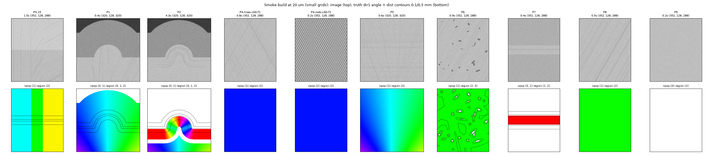

# Phantoms and validation

Every claim about a method is a measured difference between a phantom and its **twin** — the same geometry without
the confound (no step, one population, no vessel) — scored by distance to the structure, over seeds, against
thresholds written down before the runs.

## The families

| id | geometry | twin | what it tests |
|---|---|---|---|
| P1 | a white-matter blade with 2.5 mm of grey matter and CSF; a fan of fibres crossing the boundary | `P1t`, no step | the grey/white shell, excision |
| P2 | P1 with U-fibres parallel to the boundary in the superficial band | `P2t` | true boundary-parallel fibres must be kept |
| P3-*d* | one white-matter slab, an interface of step *d* (0 / 8 / 15 / 30 / 40); fibres cross it at 90 / 60 / 30° | `P3-0` | the headline interface result, the ρ sweep |
| P4 | two populations of fibres crossing at 90 / 60 / 45 / 30°, fractions 1:1, 2:1, 4:1; rods as a sanity check | `P4-…-single` | N, directions, fractions |
| P5 | a fan crossed by a straight bundle (crossing angle varying continuously) | — | N where the angle varies |
| P6 | fibres plus dark vessels at random 3-D orientations | `P6t` | the vessel-halo failure |
| P7 | a 1 mm laminar slab with internal fibres, darker tissue either side | — | the callosum case |
| P8 | homogeneous oblique fibre texture | — | the clear-tissue floor; null calibration |
| P9 | noise only | — | false populations; detector nulls |



Fibres are straight lines in x–z planes at random y with a mixture of widths (σ 1 / 2 / 3 / 6 voxels), dispersed about
their population's mean direction, splatted into a density that darkens the tissue (the dehydrated-white-matter
convention) plus correlated noise. The structure is continued into the margins, so no direction near the scored core
is computed against a block face. `shapetensor.phantoms.make` builds any family at any voxel size with its truth
(directions, populations and fractions, distance to the interface and its normal, tissue class).

## Calibration to real data

The phantoms are matched to the real 20 µm S-21-46 crop (internal capsule / thalamus) with **label-free** statistics
measured by `shapetensor.phantoms.stats` on the crop and on the phantoms alike:

| statistic (bright tissue) | real crop | phantom baseline |
|---|---|---|
| noise, DoG bands 1–2 / 2–4 / 4–8 / 8–16 voxels (10% smoothest blocks) | 3.9 / 2.1 / 1.1 / 0.8 | 4.6 / 2.9 / 1.2 / 0.4 |
| texture, same bands, noise removed | 4.2 / 2.9 / 2.1 / 2.1 | 3.3 / 3.0 / 2.3 / 1.7 |
| intensity modes | 164, 126 | 164 / 126 / 60 |
| structure-tensor orientation gap, median, ρ 8 / 16 / 32 | 0.25 / 0.26 / 0.30 | ≈ 0.64 |
| Westin linear measure, median; share > 0.3 | 0.115; 5.8% | 0.03; ~0 |

Two findings shaped the design. The real noise is **correlated** (phase retrieval low-passes it), so the phantoms use
blurred white noise. And the real tissue is **less coherent and more interface-rich** than any homogeneous fibre
model: matching the orientation gap needs 30° dispersion at 0.6× amplitude, which halves the texture bands. So the
suite keeps a coherent-bundle baseline (amplitude 100, dispersion 20° / 10°) and sweeps the **texture amplitude
t ∈ {1, 0.5, 0.25, 0.1}** as the difficulty axis; by the orientation gap the real median sits between t0.25 and t0.5,
its 10th percentile near t0.1. Every result is read along that axis. A `-t<f>` suffix on a phantom id sets it
(`P3-40-t0.5`), and the null phantoms used to calibrate thresholds are taken at the same level.

## Scoring

Sites are a stride-4 grid on the mid plane of each phantom's core (a few thousand per phantom); the truth is sampled
at the sites. Per read-out:

- **angular error** to the true fibre (axial), summarised by distance band to the interface
  (0–0.1, 0.1–0.25, 0.25–0.5, 0.5–1, 1–2, > 2 mm) and in the no-interface twin: medians, 90th percentiles, shares
  under 10° and 30°;
- **boundary-parallel share**: directions within 30° of the interface's tangent plane, against the truth's share;
- **N populations**: the confusion of reported against true N; for true-2 sites the two strongest estimates matched
  to the truths by least total angle, the share with both within 15°, the fraction error; false second populations
  on single-population and null phantoms;
- **detectors**: precision–recall of "within 0.5 mm of an interface" and the quantiles on interface-free tissue,
  which calibrate every threshold (the 99th percentile of a null is the switch level);
- across seeds: the mean of the per-seed statistic with its range.

## Arms

All read-outs run on the same caches, so comparisons are never confounded by preprocessing: the intensity tensor at
ρ 8 / 16 / 32; its excised version, ungated and gated by each detector; the three shape engines' eigen and TCA
read-outs; the hybrid blend / switch; and, for the crossing phantoms, N by the earlier BIC rules, FRT peaks, CSD,
CSD with TCA refinement, CSD with a residual-bootstrap stability test, and over-complete CP with geometric grouping.

## Pre-registered thresholds

| claim | measure | threshold |
|---|---|---|
| interface fixed | step ≥ 15, within 0.5 mm | ≤ 10° (plain tensor ≥ 40°) |
| nothing lost in clear tissue | no-step twin, P8 | ≤ plain tensor + 1° |
| U-fibres kept | P2, 0.15–1.2 mm band | ≤ 10° |
| grey/white shell gone | P1 boundary-parallel share, 0–0.5 mm | within 5 points of the twin |
| crossings resolved | ≥ 45°, fraction ≥ 0.2 | N correct ≥ 95%; both directions ≤ 15° at ≥ 90% of sites |
| no false populations | single, P8, P9 | second population ≤ 2% of sites |
| fractions | 2:1 and 4:1 | error ≤ 0.1 |
| boundary field | step ≥ 15, within 0.5 mm | precision and recall ≥ 0.9 |
| vessels | within 2 radii of a tube | ≤ 15° |

How each arm fared against them is in [Results](results.md).

## Running the suite

```bash
shapetensor phantoms --pids P3-40-t0.5 P3-0-t0.5 P8-t0.5 --seeds 0 1   # build (with the calibrated texture)
shapetensor run --spec results/spec_full.json                           # caches per (phantom, seed, engine, ρ), read-outs, scores
shapetensor report --tag main                                           # REPORT.md, tables and figures
```

A `Spec` (`shapetensor.validate.suite.Spec`) lists phantoms, seeds, engines, ρ values and engine options; caches are
resumable, so a run that dies continues where it stopped. `scripts/bench/` holds the drivers, the calibration JSONs
and the logs of the validation that produced the numbers in these pages.
