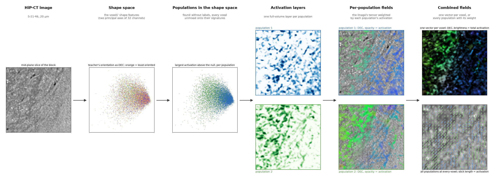

# The pipeline

Four stages, one pair of scales. `sigma` (the derivative scale) and `rho` (the integration window) are used alike
by the teacher of stage 2, by every population's tensor in stage 3 and by the baseline structure tensor the result is
compared with, so every comparison is like for like.

| stage | what it does | module |
|---|---|---|
| [1. Shape features](shape_features.md) | the block through a pretrained 3-D UNet, read at the encoder layer that encodes orientation | `shapetensor.features` |
| [2. Separating populations](separating.md) | the shape space read without labels; the populations present; one activation layer per population | `shapetensor.separate` |
| [3. One tensor per population](tensors.md) | the image's structure tensor weighted by the population's activation | `shapetensor.tensors` |
| [4. Merging](merging.md) | one vector per voxel from the merged tensors, or every population's vector with its activation as weight | `shapetensor.merge` |

`shapetensor.pipeline` runs them: `calibrate` fits stage 2 on a block, `apply` runs stages 2–4 with a calibration,
`population_field` does both on one block, `run_volume` runs a whole zarr volume chunk by chunk.

## What is and is not a parameter

What each parameter does to the field, varied one at a time on the HiP-CT block: [parameters](../parameters.md).

- The feature layer is fixed by evidence (encoder block 2 is where orientation is a linear code; `notes/`).
- The teacher is the excised structure tensor at the output `rho`; its confident sites are the top 30% by
  orientation gap, stratified over orientation; the least oriented 30% give the background signature.
- The feature average before any read-out is a 3³ box: the fibre texture's period at 20 µm is about 5 voxels, and
  the activation of a rectified filter oscillates with that phase; the average integrates it (`smooth`).
- The null `tau` is the activation a wrong population's signature reaches on single-population voxels; it is
  calibrated on the block and exported with the field, never applied to the vectors.
- A population is a mode of the window's orientation density that owns at least 5% of the tissue above the null;
  up to `nmax` (3).
