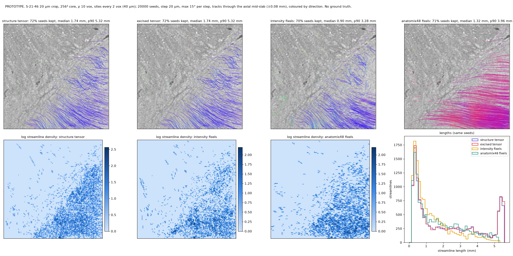

# 4. Merging population vector fields

## What the stage is for

The per-population results have to become one field a streamline builder can follow: at each site, the set of
directions present, with weights, and a verdict where there is none. The merge also decides what happens at
interfaces, in isotropic tissue, and when several stains or contrasts of the same block are available.

## One field, several vectors per site

The merged field is the fixel set per site — up to three unit directions with fractions and a count — alongside
the single-direction field of the excised tensor and its quality maps. No voxel is assigned to a population; a
site simply holds every direction found there. For a streamline builder the two are equivalent: a fixel tracker
assigns a voxel to a population by *direction continuity* — it follows the fixel most aligned with its heading —
which is exactly how co-located, interleaved vertices (one direction each) are consumed.

`st.run_volume` writes the merged field chunk by chunk in the `structure-tensor` package's layout, so it can stand
in wherever that package's output is read:

| array | shape | content |
|---|---|---|
| `S`, `S_excised` | (6, Z, Y, X) | the tensors, [xx, yy, zz, xy, xz, yz] |
| `val`, `vec`, `vec_excised` | (3, Z, Y, X) | eigenvalues; the single direction (x, y, z), plain and excised |
| `dirs`, `fracs`, `npop` | (3, 3, Z, Y, X), (3, Z, Y, X), (Z, Y, X) | the fixels |
| `gap`, `cl`, `gm` | (Z, Y, X) | the quality maps |

```python
vec  = st.cp.shapetensor(image, rho=10.0)                     # the single direction, excised
dirs = st.cp.shapetensor(image, rho=16.0, fixels=True)        # (3, 3, Z, Y, X), strongest first, zero where absent
```

## Three rules of the merge

1. **Interfaces carry no fixels.** Sites whose coarse gradient exceeds 3× the median report `npop = 0` — the same
   scale criterion as the excision. A contrast sheet deconvolves to a ring of directions, so fixels there are false
   (N ≥ 2 at 30–100% of sites within 0.5 mm of a step, gyral boundary or vessel before the gate; results log §13);
   the excised tensor's single direction is the field there.
2. **No population comes from the tensor's anisotropy, not from the fixels.** The deconvolved ODF of isotropic
   noise has peaks as high as a fibre's (10–16× the mean), so the fODF cannot say "nothing here"; the orientation
   gap (and `cl`) can, and the builder's N = 0 verdict for grey matter and CSF is a threshold on them.
3. **The two fields can use different windows.** The single direction is good at ρ 10 (0.2 mm) at the real
   texture level; crossings need ρ ≥ 16 (60° both-within-15°: 68% at ρ 10, 94% at ρ 16, 100% at ρ 32).

## Several stains or contrasts

Co-registered volumes of the same block are merged at the input, not the output: passing a list adds the tensors
(the structure tensor of the channel stack), and with a shape engine concatenates the features of every stain:

```python
vec = st.cp.shapetensor([cell_stain, myelin_stain], rho=10.0, engine="anatomix48")
```

On the phantom pairs (`scripts/bench/two_stain_test.py`) this behaves as tensor averaging: two realisations of one
stain gain the expected √2 far from structures (4.4° → 3.0°) and nothing at the interface, which both share; a
fibre-rich stain plus a weak-texture, strong-boundary stain reads like the fibre-rich stain alone; concatenating
the shape features of a weak stain degrades the joint read-out (6 → 24° at the step) while the crossing keeps its resolution (46 → 51%).
The merged field is as good as the best stain, not better — stain weights belong in the merge. (BigBrain has one stain, so this stays a phantom result until a co-registered pair exists.)

## Following the merged field

`shapetensor.tracking` is a deterministic streamline tracker for (multi-)vector site grids, batched on the GPU:
from every seed, both ways, the nearest site's most aligned fixel, a fixed step, stop on leaving the mask, on a
turn above the angle threshold, on a site without fixels, or at the maximum length. It is one tracker for every
field, so a comparison between fields is a comparison of fields: streamline lengths and terminations, how often a
secondary fixel was followed, the density maps' Dice and correlation, and the per-seed divergence from the
single-vector track (`scripts/demo_tractography.py` on the HiP-CT crop; `tracking.track`, `density`,
`endpoint_divergence`).



## Validation

- The tracker on synthetic fields: a straight field crosses a band of a second population without turning; a
  circular field is followed at constant radius; density and divergence are exact on identical inputs.
- The merge rules on phantoms: the gated N ≥ 2 share by band (0–0.25 mm bands removed at a step and gyrus; the far
  field at the dispersed-tissue false rate); the crossing phantom's fixel tracks pass through the crossing.
- On real data: the fixel tractogram against the tensor tractogram — Dice, correlation, divergence — says how much
  the multi-vector field changes the result, with no truth to say which is right.
