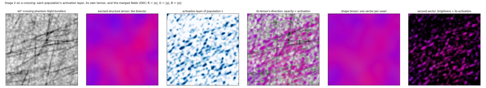

# 2. Separating populations in the shape space

Stage 2 answers two questions without labels: *which* fibre populations are present in a window, and *where* each
of them is, voxel by voxel. Its readers are fitted on the block itself.

## The teacher

The excised structure tensor at the output ρ is the teacher: at its confident sites (the top 30% by orientation
gap in the tissue, drawn evenly over orientation bins so that no direction dominates) its direction is taken as
that voxel's orientation. No labels, no annotation. The least oriented 30% of the tissue give a *background*
pattern.

## Two readers of the shape space

**The signature dictionary** is the mean standardised feature pattern of every orientation (160 directions on a
hemisphere, kernel-smoothed), plus the background pattern. The signature of any direction is interpolated from it.

**The orientation readout** is a small network from a voxel's features to a distribution over the same 160
directions, trained with the teacher's direction as a soft target. Summed over a window, the voxels' distributions
are the window's **orientation density**, whose peaks are the candidate populations.

Both are fitted by `shapetensor.pipeline.calibrate` on one block (real data) or on a set of single-population
blocks (phantoms at several orientations), and both are applied unchanged to any block of the same data.

## Which populations: candidates confirmed by their layers

The readers do not respond equally to every direction (the network's filters are not isotropic), so both are
gain-normalised per direction against the teacher on the calibration block: the density by the ratio of what the
readout reports to the teacher's own orientation histogram, the activations by what a sample reaches on its own
direction's signature. Every direction then counts alike.

The density's peaks still over-count: a single population with dispersed fibres has shoulders that a peak finder
reads as further populations. The pipeline therefore takes up to four candidates and lets stage 3 judge them:
the candidates are unmixed together into their activation layers (below), and each layer's own population
tensor — the image's gradients weighted by that activation — gives the direction its fibres actually have. The
shoulders of one population all point at that population; a real second population points elsewhere. The
populations are the *distinct* layer axes (25° apart), refined once from their own layers, and a population must
also own at least 5% of the tissue above the activation null. The joint unmixing is kept to at most four
signatures, within the rank of the orientation code.

## Where each population is: the activation layers

Every voxel's feature vector is decomposed non-negatively onto the signatures of the populations found plus the
background:

$$x(v) \approx \sum_r a_r(v)\, D(\theta_r) + b(v)\, D_\text{bg}, \qquad a_r \ge 0$$

The coefficients $a_r(v)$ are the **activation layers**: one full-volume image per population of where that
population's shape is, not a mask of the image. They are what stage 3 weights the image gradients with and what
stage 4 uses as weights. The *null* $\tau$ — the activation a wrong population's signature reaches on
single-population voxels, calibrated on the block — is exported with every field; it is never applied to the
vectors.

## What this stage cannot do

With the second-order orientation code of the features (stage 1), a voxel whose receptive field holds two
populations looks like a weaker single population at their bisector, and three populations are linearly
dependent. Separation therefore works where the populations interdigitate at the fascicle scale, and it degrades
as the crossing angle closes and as the fibres within a population disperse: see [validation](../validation.md).
