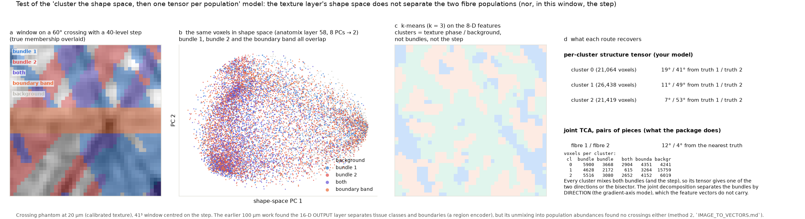
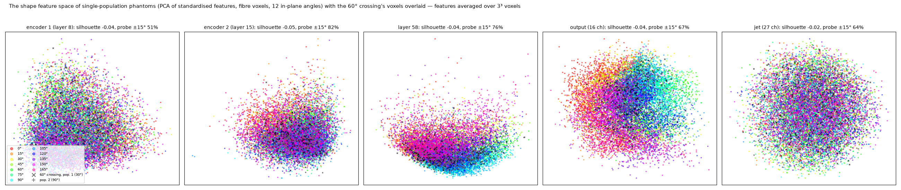
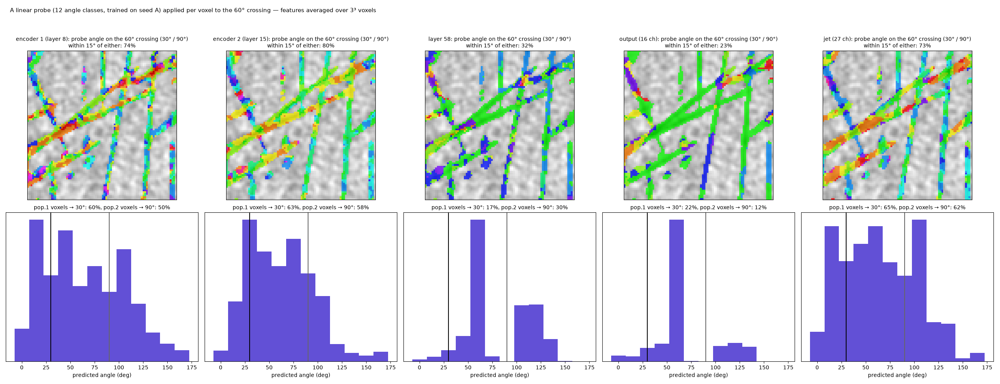

# 2. Separating populations in shape space

## What the stage is for

Where two or more fibre populations share a window — a crossing, a kissing, a bundle passing through a fan — one
direction per site is wrong for all of them. The stage has to decide how many populations there are (N) and which
of the local evidence belongs to which, so that the next stage can fit one tensor per population.

## As drawn: cluster the shape space

The drawn pipeline separates in *feature space*: each voxel's shape-feature vector is a point in R^C; cluster the
points, and each cluster is a population. The assumption underneath is that a voxel's local appearance identifies
its population.

The suite tested this on the crossing phantoms (results log §7; `fig_shape_space_clusters.py`):

- On a 60° crossing the two bundles' layer-58 feature vectors overlap completely; k-means clusters follow the
  texture phase and the background, not the bundles.
- A tensor on each cluster's voxels returns one bundle or the bisector.
- Projecting the features onto the channel signature of a TCA pair does not help either (signature |cos| 0.6–0.9
  between bundles).

The reason is structural rather than a matter of tuning: two crossing bundles are the same tissue with the same
stain response and the same texture statistics — they differ **only in orientation** — so a feature space can
separate them only if it encodes orientation, and the engines' output features are nearly orientation-invariant
(previous page). The clustering step has nothing to cluster.

## Where the space divides: the feature-space study

Before changing the method, the question is whether the shape space divides by orientation at all, and where
(`scripts/fig_feature_space.py`; results log §18). Single fibres at 12 in-plane angles, per-voxel features from
four depths of the network and from the jet, a linear 12-class readout trained on one realisation and tested on
another, and the same readout applied per voxel to a 60° crossing:

| shape space | orientation readable per voxel (±15°) | 60° crossing: voxels within 15° of either truth | each population's voxels assigned to it |
|---|---|---|---|
| encoder 1 | 51% | 74% | 60 / 50% |
| **encoder 2** | **82%** | **80%** | **63 / 58%** |
| layer 58 (`anatomix48`) | 75% | 32% | 17 / 30% |
| output (`anatomix16`) | 67% | 23% | 22 / 12% |
| jet (no network) | 64% | 73% | 65 / 62% |

Two facts fix the stage's design:

1. **The space is ordered by orientation as a continuum, not clustered** (every silhouette ≈ 0 while a linear
   readout works): the division has to find modes along the orientation axis of the space, not clusters in all of
   its dimensions — which is why k-means found texture phase.
2. **Per-fascicle division works in the shallow, orientation-selective space and fails in the deep one.** With
   encoder-2 features each fascicle of the crossing is coloured by its own orientation; with layer 58 or the output
   every voxel collapses to the bisector, because those receptive fields average the two populations before any
   separation can act. The stage therefore runs at the fascicle scale (a few voxels) in encoder block 2 — exposed
   as the `anatomix_enc2` engine — before the ρ-window integration.

## The separation, label-free

With the layer and the scale fixed, the method is a label-free decomposition of each window's voxel cloud in the
shape space (`readout.populations`): the principal *signatures* of the voxels' channel-energy patterns are the
populations present; each voxel's membership of a population is its projection on that signature; N is the number
of signatures whose eigenvalue exceeds a null threshold calibrated on single-population windows; and the stage's
output is one membership map per population. No k-means, no labels. The TCA decomposition of the channel-resolved
tensor is the same idea phrased on gradients (its pieces carry channel signatures), and is kept as the second
form. `scripts/bench/separate_shape_space.py` scores both against the truth-split ceiling on the crossings, in the
encoder-2 and the layer-58 spaces.

## Beyond the window: fascicles

The per-voxel readout above (82% within ±15° in encoder 2) is what makes a *spatial* form of the division possible:
at 20 µm fascicle boundaries are visible, so voxels that share an orientation and are connected form a fascicle,
and a tensor per fascicle follows with no decomposition at all — an orientation-coherence watershed on the
encoder-2 orientation map, or a learned fascicle map. That is the study after the window-level separation.
