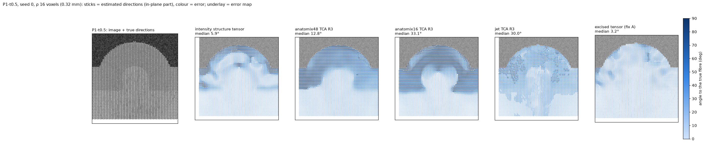

# 3. Getting tensors from populations

## What the stage is for

Given the evidence assigned to a population — a set of voxels, or a component of the local gradient
distribution — fit the tensor that gives its direction, and attach a quality to it. One direction per population;
for a single population this is the ordinary structure-tensor read-out.

## The channel-resolved tensor and TCA

With `C` channels of features, each site holds the channel-resolved tensor
`K = G_ρ ∗ (g gᵀ)`, `g` the stacked channel gradients, a `3C × 3C` matrix (packed, `tensor.k_sites` /
`k_dense`). Its `3 × 3` diagonal blocks are the per-channel structure tensors; their sum is the **shape tensor**
(`st.shape_structure_tensor_3d`), the structure tensor of the channel stack. TCA — a CP decomposition of the
per-site 3-way array `(channel, axis, axis)` — asks for a few rank-one pieces, each a direction `d` with a
channel signature: `K ≈ Σ_r λ_r (b_r ⊗ d_r d_rᵀ)`.

- **One population** (`readout.single.tca`, rank 3): the three pieces span the gradient plane; the fibre is the
  null direction of their Gram, and the gap between the pieces' weights is the quality.
- **N populations** (`readout.multi`, rank 2N with geometric pairing): pairs of pieces whose directions are
  orthogonal share a null direction, which is a population's fibre; the pairing is the assignment of evidence to
  populations.

When the assignment is right, the decomposition works: with the voxel sets chosen by the truth (an oracle split),
a tensor per bundle recovers 8° / 7° on the 60° crossing, and the CP fit recovers planted directions
(`tests/test_core.py`). The limit is the assignment, as the previous page shows, not the tensor.

## The population tensor from the ODF: fixels

The built pipeline takes the populations from the ODF peaks (previous page) and reports each as a **fixel**:
a unit direction, a fraction, and the count per site (`st.fixels_3d`; `dirs (3, 3, ...)`, `fracs (3, ...)`,
`npop`). A fixel is the population's "tensor" reduced to what a streamline builder consumes — the direction and
its weight; the per-population second moment is available from the CSD peak's width if needed.

```python
dirs, fracs, npop = st.fixels_3d(volume, sigma=1.0, rho=16.0, peak_rel=0.5, interface_gate=3.0)
```

## The single-direction field: the excised tensor

Where there is one population — most white matter at these windows — the best tensor is not the shape tensor but
the intensity structure tensor with the interface gradients removed (`st.excised_structure_tensor_3d`): gradients
whose coarse-scale (σ = 3) magnitude exceeds 3× the median are dropped and the integration is renormalised. Scale
separates the interface's delta from the texture's ring where no appearance feature can, because the texture has no
energy at σ = 3 and the interface has all of it.

| within 0.1 mm, ρ 8 / 16 / 32 | plain tensor | excised | clear tissue |
|---|---|---|---|
| step 40, half texture | 41 / 13 / 7° | **5.4 / 2.9 / 2.1°** | 5.9 / 2.8 / 2.1° |
| gyrus, half texture | 34.5 / 16 / 5.0° | **5.2 / 2.5 / 1.9°** | 3.3 / 1.9 / 1.3° |
| vessel, half texture | 24.7 / 11.8 / 5.3° | **8.2 / 3.3 / 1.3°** | — |
| at ρ 10: step / gyrus / vessel | 33.5 / 28.7 / 22.9° | 4.5 / 4.2 / 6.3° | 4.5 / 2.6 / — |

Nothing is lost in clear tissue or on U-fibres (0.1°), the laminar slab is untouched, and it costs 6%. The
`anatomix48` TCA direction does not rescue the interface (44° at the step at ρ 10) and sits 25–42° from the
structure tensor on real blocks with an over-confident gap; it is kept as the documented negative result and as the
ODF's gradient source.

## Quality per population

- the **orientation gap** (λ₂ − λ₃) / λ₂ of the tensor: how well the single direction is determined (0.23–0.26 in
  real white matter at ρ 10–16 — weakly);
- Westin's **cl**: how sheet-like the window is (a sheet has one direction that is not a fibre);
- the **coarse gradient magnitude** `gm`: how much an interface dominates (the boundary detector: PR-AUC 0.85–0.96
  at ρ 16);
- for fixels, the **fraction** and the count.

## Validation

The scorecard rows this stage owns: "interface fixed" (met by the excision at ρ 16 and 32, and at ρ 10 at the
real texture level), "nothing lost in clear tissue", "U-fibres kept", "vessels"; "crossings resolved at 60°" (met
by anatomix48 CSD at full texture with a compliant threshold); "fractions" (0.04 at 4:1). Every arm and every
phantom is in `scripts/bench/SCORECARD_main.md` and `SCORECARD_rho10.md`; the glyph figures
(`scripts/fig_glyphs.py`) show the sticks coloured by error for each arm.


