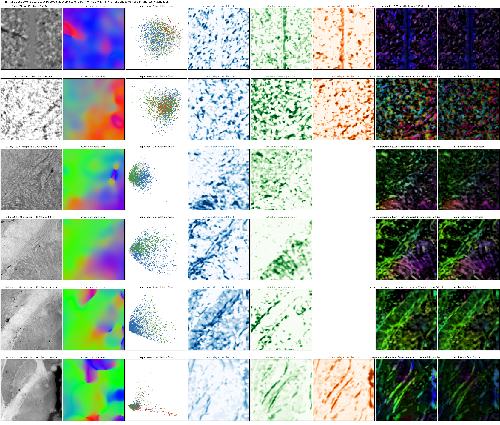
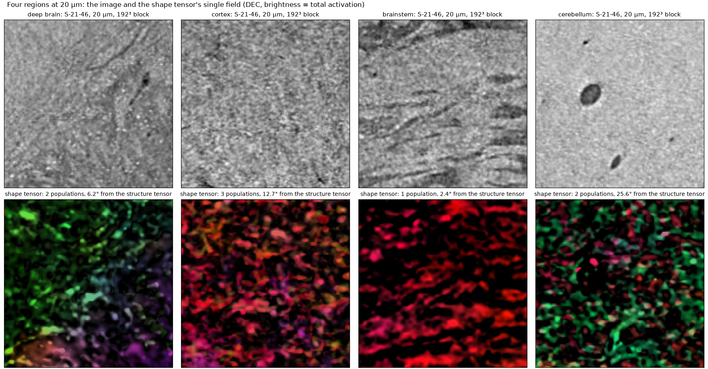
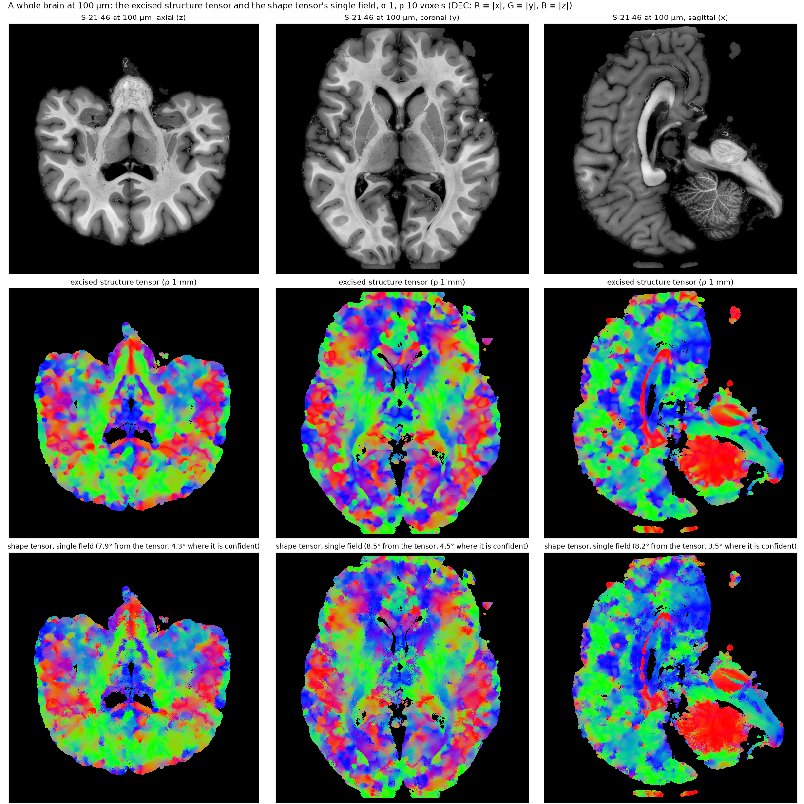

# Scales, regions, a whole brain

The same pipeline, at the same settings (σ 1, ρ 10 voxels, calibration on the 384³ around a 192³ block, tissue =
grey level above zero), on HiP-CT at six voxel sizes, on four regions of one brain at 20 µm, and over a whole brain
at 100 µm. There is no truth on real data; what is reported is what the pipeline finds, and how far its single field
is from the excised structure tensor at the same scales, over the tissue and where the tensor is confident (its top
quarter by orientation gap).

```bash
python scripts/scales.py            # docs/img/scales.png, docs/img/regions_20um.png, results/scales.json
python scripts/wholebrain.py run    # the 100 µm brain: shape.zarr and st.zarr under /hdd/andrew/shapetensor_runs
python scripts/wholebrain.py figure # docs/img/wholebrain_100um.png, results/wholebrain_100um.json
```

## Six voxel sizes

The two finest blocks are from I74 (a 2.2 µm volume of interest and a 10 µm chunk); the four coarser ones are the
deep brain of S-21-46, at 20 µm from its 20 µm scan and at 50, 100 and 200 µm from the levels of its 50 µm scan,
centred on the same thalamic site. The parameters are in voxels, so the integration window runs from 22 µm to
2 mm down the figure and the network's 16-voxel receptive field from 35 µm to 3.2 mm.



- **From 20 µm to 100 µm** the pipeline reads the deep brain as two populations and its single field is within 5°
  of the excised tensor where the tensor is confident (6° to 12° over the block). At 50 µm the activation layers
  follow the fascicles that are visible in the image, one layer per direction of fibre bundle.
- **At 200 µm** the receptive field is 3 mm and the three "populations" are tissue classes: a band of white matter,
  the oriented edge of the ventricle, the rest. The field still agrees with the tensor (10°, 6° where confident),
  because both are now reading anatomy, not fibres.
- **At 2.2 µm and 10 µm** the voxels resolve cells, vessels and single axons. The features are read at a receptive
  field of 35 µm and 160 µm, the readers calibrate on whatever is oriented at that scale (a vessel is one of the
  three populations at 2.2 µm), and the single field departs from the structure tensor by 20° to 25°. The
  pipeline reads shape at the scale of its receptive field; the voxel size decides what a "fibre" is. For
  sub-cellular voxel sizes, downsample to the fascicle scale first.

## Four regions at 20 µm

Deep brain, a gyral white-matter site, the brainstem and the cerebellar white matter of S-21-46, each a 192³ block.



The brainstem block shows the one real failure mode of self-calibration: its fibres run in one direction, the
teacher occupies 7 of 24 orientation bins, the readers cannot learn an orientation code from one orientation, and
the null rises until 6% of the tissue is above it. The field is then the excised tensor weighted by a degenerate
activation (2° from the tensor, with weights that say nothing). The remedy is the one `run_volume` applies: **one
calibration per volume**, fitted on a block that holds many orientations and applied everywhere; the second row of
the figure is the four regions under the deep-brain block's calibration.

## A whole brain at 100 µm

S-21-46 at 100 µm (1475 × 1493 × 1493 voxels, level 1 of its 50 µm scan), calibrated once on the central 256³,
run chunk by chunk with chunks without tissue skipped, and the excised structure tensor over the same volume at the
same σ and ρ (1 mm integration).


