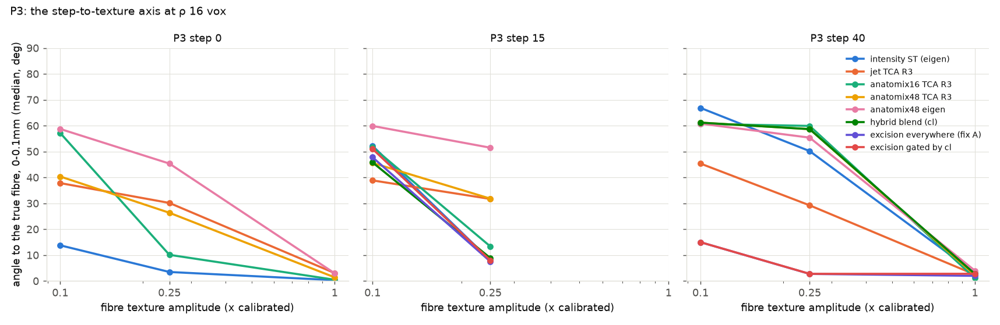

# The structure tensor and where it fails

## What it computes

For an image \(I\), the structure tensor at a point is the Gaussian-weighted sum of the outer products of the
image gradient over a window:

$$
S(\mathbf{x}) = \big(G_\rho * \nabla I_\sigma \nabla I_\sigma^{\mathsf T}\big)(\mathbf{x}),
\qquad \nabla I_\sigma = \nabla (G_\sigma * I),
$$

with \(\sigma\) the derivative scale and \(\rho\) the integration scale, both in voxels. \(S\) is symmetric and
positive semidefinite; its eigenvalues \(\lambda_1 \ge \lambda_2 \ge \lambda_3\) measure how much the image changes
along each principal direction. A fibre's texture changes *across* the fibre and not along it, so a fibre population
fills the plane perpendicular to itself with gradients and the fibre direction is the eigenvector of the **smallest**
eigenvalue, \(\mathbf e_3\). The tensor is *planar* for a fibre (\(\lambda_1 \approx \lambda_2 \gg \lambda_3\)) and
*linear* for a sheet or an edge (\(\lambda_1 \gg \lambda_2 \approx \lambda_3\)).

`shapetensor.st.structure_tensor_3d` computes exactly this, with the `structure-tensor` package's layout
(`S = [Sxx, Syy, Szz, Sxy, Sxz, Syz]`, \(x\) the last axis) and scipy-identical filters, on the GPU;
`eig_special_3d` returns the eigenvalues and \(\mathbf e_3\).

## The failure modes

### Tissue interfaces: the boundary shell

At an intensity step — the grey/white boundary (ethanol-dehydrated white matter is bright in HiP-CT), the interface
between two tracts, a vessel wall — the step contributes a bundle of gradients all along its normal \(\mathbf n\). If
its energy dominates the window, \(S\) becomes linear: \(\mathbf e_1 = \mathbf n\) and \(\lambda_2 \approx \lambda_3\),
so \(\mathbf e_3\) is an arbitrary direction *in the plane of the boundary*. Every vertex within reach of the
interface then reports a boundary-parallel direction, a graph or tracker links them into a sheet, and streamlines
wrap along the cortex instead of entering it. Measured at 100 µm on a whole brain: within 0.5 mm of the mask edge
88–93% of the directions lie in the boundary plane, and 27% of all streamline length runs in such surface-parallel
runs (8% in a diffusion-MRI reference). The shell's thickness grows with \(\rho\).

The phantoms show when this happens: it is a **step-to-texture-ratio** effect. At 20 µm, next to a 40-level step
(the real internal-capsule / thalamus step is about 38), the error within 0.1 mm of the interface is

| texture level | ρ 8 | ρ 16 | ρ 32 | clear tissue |
|---|---|---|---|---|
| full (coherent bundle) | 7° | 3.5° | 2.4° | 2–5° |
| half (the real crop's median lies between a quarter and a half) | **41°** | **13°** | 7° | 3–6° |
| a quarter | **58°** | **53°** | **42°** | 3–14° |

### Crossings and fans

Two populations crossing in one window fill two planes with gradients. Their sum has no single null direction: the
tensor reports the bisector of the two fibres (or, for a near-perpendicular crossing, the common normal), and the
orientation gap \((\lambda_2 - \lambda_3)/\lambda_2\) collapses, so the vertex is both wrong and low-confidence. No
choice of \(\rho\) repairs this; it is a limit of a single second-order tensor.

### Scale

A small window has no support in homogeneous white matter: at 20 µm and a tenth of the real texture, the error in
clear tissue is 44 / 22 / 9° at ρ 8 / 16 / 32 — the median \(|z|\)-component of the estimated directions sits at the
value for isotropic random directions. A large window gathers more texture but, at an interface, more of the step.
At 20 µm the trade-off tips the other way than at 100 µm: the step is one thin sheet and a larger window gathers more
fibre texture, so the shell *shrinks* with \(\rho\) (gyrus phantom, half texture: 34 / 16 / 5° within 0.1 mm of the
grey/white boundary against 6 / 3 / 3° for the no-step twin).

### Vessels and laminar bundles

A dark tube is a strong cylindrical edge: its gradients fill the plane perpendicular to the tube's axis, exactly as a
fibre's do, so the tensor reports the vessel's axis as a fibre, with high anisotropy. A laminar bundle with internal
texture (the corpus callosum) has \(\lambda_3 \gg \lambda_2 \gg \lambda_1\) in gradient terms: a well-determined
\(\mathbf e_3\) that a "tube or sheet" shape gate wrongly rejects.

## What fixes the interface failure

**Gradient excision.** Drop the gradients whose coarse magnitude (\(\sigma = 3\) voxels) exceeds a multiple of the
volume median — the step's gradients and little else (0–1% of voxels) — and renormalise the integration:

$$
S_{\mathrm{ex}} = \frac{G_\rho * (w\, \nabla I \nabla I^{\mathsf T})}{G_\rho * w},
\qquad w(\mathbf x) = \big[\,|\nabla I_{\sigma_c}(\mathbf x)| \le f \cdot \operatorname{median}|\nabla I_{\sigma_c}|\,\big].
$$

On the phantoms this takes the interface error from 60 / 50 / 37° to **7.9 / 2.7 / 1.8°** at a quarter of the
texture, and from 41 / 13 / 7° to 3 / 2 / 1° at half, while clear tissue is unchanged to 0.1°, and true
boundary-parallel fibres (U-fibres in the superficial band) are kept (1–3°). It is the default of
`shapetensor()` (`excise=True`); `excised_structure_tensor_3d` exposes it. Where there is no texture to recover
(a tenth of the real texture at ρ 8) nothing helps but a larger window.

**Detecting the boundary.** The coarse gradient magnitude is the best detector of "within 0.5 mm of an interface"
(precision–recall AUC 0.85–0.96 at ρ 16 at every texture level); Westin's linear measure
\(c_l = (\lambda_1 - \lambda_2)/\operatorname{tr} S\) of the tensor fires only when the step *dominates* the window,
which is exactly when the orientation is at risk, so it is the right reliability flag. Both are written into the
orientation field (`gm`, `cl`).

## What was tried and did not work

The shape-space tensors and their tensor component analysis — the subject of [the theory page](theory.md) — were
the proposed remedy for the interface failure. At 20 µm with realistic statistics they do not rescue the orientation
there: the UNet's output layer is blind to weak texture, its texture layer keeps a 26–30° floor at a quarter of the
texture and still carries the step, and a locally normalised derivative jet is step-insensitive but orientation-poor.
The evidence is in [Results](results.md).
