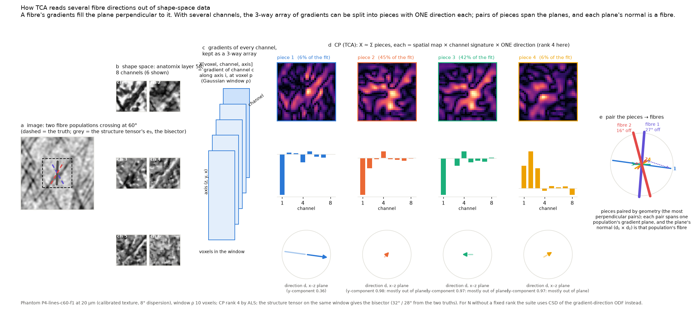
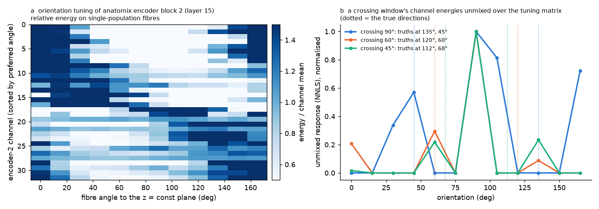

# Theory of the shape tensor

## From one channel to many

Replace the image by a **feature field** \(f: \mathbb R^3 \to \mathbb R^C\) — \(C\) channels per voxel — and sum the
structure tensor over channels:

$$
T(\mathbf x) = \sum_{c=1}^{C} \big(G_\rho * \nabla f_c \nabla f_c^{\mathsf T}\big)(\mathbf x).
$$

This is the *shape tensor* when \(f\) is the "shape space" of a pretrained contrast-agnostic 3-D UNet (anatomix),
and the plain structure tensor when \(f = I\). The hope behind it: a network trained to give the same features to the
same anatomy under any appearance should see a fibre's texture in many channels and a brightness step in few, so
that in \(T\) the step is "one small change among many texture channels" and \(\mathbf e_3\) stays with the fibres.
ShapeTensor's **feature engines** are the choices of \(f\):

| engine | channels | what |
|---|---|---|
| `intensity` | 1 | the image; the control |
| `jet` | 27 | Gaussian derivatives of orders 1–2 at σ = 1, 2, 4, each divided by its local RMS (no network) |
| `anatomix16` | 16 | the UNet's output layer (a region / boundary encoder) |
| `anatomix48` | 48 → 16 PCs | the UNet's last full-resolution layer before the output head (texture + context) |

The anatomix engines are run cleanly: 256-voxel tiles with 64-voxel discarded margins (a tile edge perturbs the
features slowly, but the read-out moves by 0.03°), no sliding windows, reflect padding, and no de-checkerboarding
(the network's period-2 artefact changes the read-out by 0.03°; averaging grid phases costs 8×).

## The channel-resolved tensor

Keep the channels apart. With \(g(\mathbf x) \in \mathbb R^{3C}\) the concatenated gradients of all channels at a
voxel (index \(c \cdot 3 + i\)), the **channel-resolved tensor** is

$$
K(\mathbf x) = \big(G_\rho * g\, g^{\mathsf T}\big)(\mathbf x) \in \mathbb R^{3C \times 3C},
$$

a Gram matrix whose channel-summed \(3 \times 3\) blocks give back \(T\). ShapeTensor computes \(K\) on a site grid
(`tensor.k_sites`, `k_dense`): the products are formed at full resolution where the texture lives, block-averaged by
\(b = \rho / 4\) voxels, and smoothed with \(G_{\rho / b}\) on the coarse grid — the effective window is
\(G_\rho\) convolved with a \(b\)-voxel box, 1% wider. With 16 channels \(K\) has 1176 distinct entries per site.

## Tensor component analysis

Per site, the windowed gradients form a 3-way array

$$
X[p, c, i] = \sqrt{G_\rho(\mathbf x_p)}\; \partial_i f_c(\mathbf x_p) \qquad (p\ \text{voxel},\ c\ \text{channel},\ i\ \text{axis}),
$$

whose gradient-axis Gram is \(T\). **TCA** fits \(X\) by a CP (PARAFAC) decomposition into \(R\) rank-1 *pieces*,
each a spatial map × a channel signature × **one direction**:

$$
X \approx \sum_{r=1}^{R} a_r \otimes b_r \otimes d_r, \qquad \|b_r\| = \|d_r\| = 1 .
$$

Exactly and much smaller: CP of \(X\) equals CP of \(L^{\mathsf T}\) reshaped to \((3C, C, 3)\), where \(L\) is the
Cholesky factor of \(K\) — so the per-site problem is \(48 \times 16 \times 3\) and millions of sites batch on a GPU
(`readout.multi.cp_als`, alternating least squares with a structured start).

Why the channels matter: with one channel \(X\) is a matrix, a rank-\(R\) matrix factorisation is not unique (any
rotation of the factors fits equally) and the only identifiable read-out is the SVD, i.e. the eigendecomposition.
With several channels CP becomes identifiable (Kruskal's condition \(k_A + k_B + k_D \ge 2R + 2\)), and the pieces'
directions need not be orthogonal — a step's normal that is not at right angles to the fibres can be named.

**Read-outs** (`readout.single`, `readout.multi`):

- *one fibre*: the direction the pieces do not use — the null vector of \(\sum_r \lambda_r^2 d_r d_r^{\mathsf T}\),
  with \(\lambda_r^2\) the piece's energy;
- *several fibres*: two pieces per population (a population's gradients span the plane perpendicular to it), paired
  by geometry — the perfect matching whose pairs are most perpendicular — with each pair's fibre \(d_r \times d_s\);
- *a boundary*: a piece with a sheet-like map, one signature and one direction, its normal.

On a 60° crossing with the anatomix texture channels, CP at rank 4 finds, for each population, an in-plane piece and
an out-of-plane piece; pairing recovers both fibres within 5° where the single tensor gives the bisector
(28° / 32° off). The CP fit is not always stable, though — the same window fitted again can land on a different
pairing 26° / 30° off — one reason the rank-free route below is preferred for the multivector field.

### What shape space does and does not separate

A natural alternative — partition the feature vectors into fibre populations and a boundary class, then one tensor
per population — does not work, because shape space encodes *what kind of structure* is at a voxel, not its
orientation. Two bundles of the same tissue occupy the same region of feature space; k-means on them follows texture
phase and background; a tensor per cluster gives one bundle or the bisector. The TCA pieces' channel signatures do
not distinguish the bundles either (|cos| 0.6–0.9). Orientation enters only through the gradient *axis* mode, which
is why TCA is one joint decomposition per window, not one per population.

Orientation *is* encoded inside the network — in its **encoder**: the second encoder block's channels are cleanly
orientation-tuned (selectivity up to 0.83 between two crossing bundles), while the output layer, trained for
contrast-agnostic correspondence, is orientation-blind (0.06). A small phantom-trained head on that block reads a
voxel's orientation at 73% within ±15° and separates a 90° crossing by voting; tighter crossings need better
angular resolution than a linear head gives. This is the direction for learning per-population channel sets.

## The gradient-direction ODF and spherical deconvolution

Discard *where* the gradients are and keep only *which way they point*: the energy-weighted distribution of unit
gradient directions on the sphere, expanded in even real spherical harmonics (order 8 by default):

$$
\Phi(\mathbf u) = \sum_{c} \sum_{p} G_\rho(\mathbf x_p)\,|\nabla f_c(\mathbf x_p)|^2\;
\delta\!\big(\mathbf u - \widehat{\nabla f_c}(\mathbf x_p)\big).
$$

One fibre population paints a **great-circle ring** on the sphere, two crossing populations two rings, a boundary a
single **spot** at its normal. Exactly as in diffusion MRI — where the signal is high perpendicular to a fibre — the
Funk–Radon transform turns each ring into a peak at the fibre (q-ball), and **constrained spherical deconvolution**
(CSD) with the single-population ring as the response (its width measured on a single-population phantom, 23–30°)
sharpens it: the fibre orientation distribution \(F\) solves

$$
\min_F \|R \ast F - \Phi\|^2 + \lambda\, \|L F\|^2, \qquad F \ge 0,
$$

iterated with the non-negativity constraint on a hemisphere grid. Its peaks are the populations, their heights the
fractions, and the number of peaks above a null-calibrated threshold is \(N\) — **no rank is chosen in advance**.
A boundary's spot deconvolves into a broad band, not a peak. This is `fixels_3d` and the `fixels=True` branch of
`shapetensor()`; `odf.csd` and `odf.peaks` run it batched on the device.

## Excision, detectors and the hybrid

The intensity-side remedy for the interface, gradient excision, is in [the structure-tensor page](structure_tensor.md);
`tensor.excision_weights` builds the weights, optionally gated by a boundary-strength map so excision applies only
near detected interfaces. Boundary detectors per site: the coarse gradient magnitude (`gm`), Westin's linear measure
of the intensity tensor (`cl`), the orientation gap \((\lambda_2 - \lambda_3)/\lambda_2\) as a quality, and the TCA
pieces' dominance. `readout.hybrid` blends or switches between the intensity and shape directions by any detector at
its null-calibrated threshold.

## Numerics

Filters are scipy-identical Gaussian derivatives (`mode='nearest'`) in torch, so one-channel \(K\) equals the
structure tensor to float32 rounding (tested). Everything runs on the device: the tensor passes, the Cholesky and
CP batches, the spherical-harmonic projection, CSD's batched solves, and the vectorised peak search.
