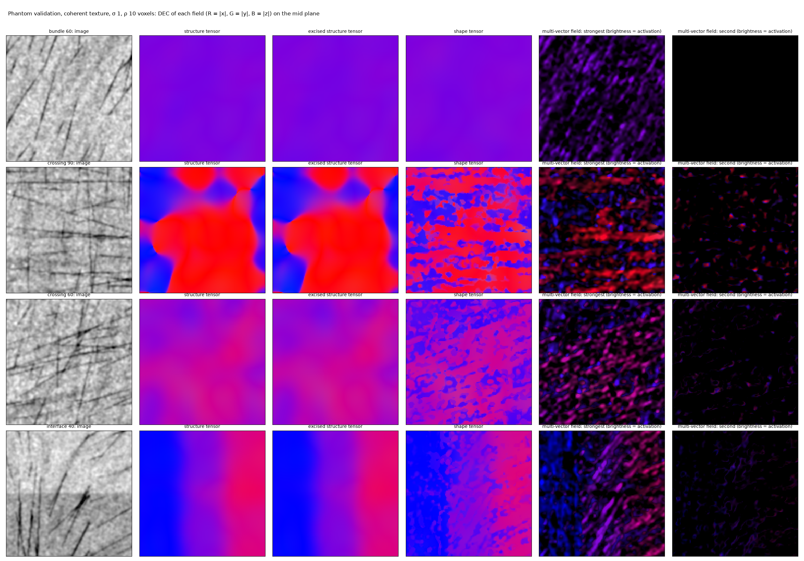
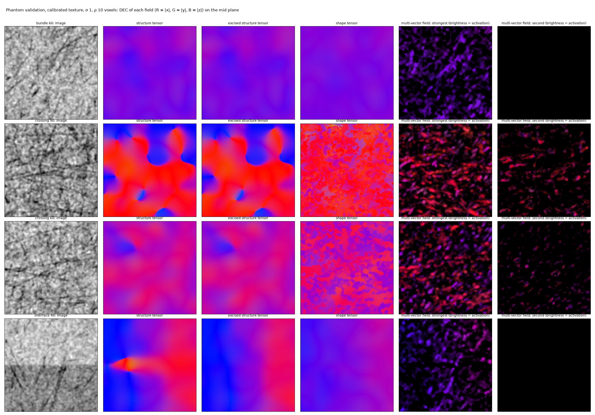

# Validation on phantoms

Three phantoms with truth, at 20 µm voxels, 192³ blocks with 32 voxels of context, three seeds each; every field
at σ 1, ρ 10 voxels. The structure tensor (plain and excised) is scored against the shape tensor's single field
and, at crossings, its multi-vector field. Two texture settings: **coherent** bundles (8° dispersion of the fibres
within a population, the full fibre darkening) and the **calibrated** texture (20° dispersion and half the
darkening, where the real HiP-CT crop lies).

```bash
shapetensor validate --out validation        # validation.json, validation_coherent.png, validation_calibrated.png
```

The shape pipeline is calibrated once on twelve single bundles at 15° steps of orientation (a phantom block has
one or two orientations, too few to calibrate on itself; a real block has them all).

## The three phantoms

- **bundle** — one population at 60°: the clear-tissue floor.
- **crossing** — two populations at 90° or 60°, equal density, interdigitated at the fascicle scale.
- **interface** — one population crossing a tissue step of 40 grey levels, at 90°, 60° and 30° to it in three bands.

## What the pictures show



With coherent bundles the pipeline finds the right number of populations on every phantom (one on the bundle
and across the interface, two on both crossings), and at a crossing the structure tensor is the bisector while
the multi-vector field carries two directions. The directions of the second population are still inaccurate on
this crossing (below), which is the one thing pass two of the release review addresses first.



At the calibrated texture the step drags the plain structure tensor by 35° within 0.1 mm of the boundary; the
excision removes this (6°), and the shape tensor inherits the excision. The crossings are no longer separable per
voxel: the fibres within a population spread over 20°, the per-voxel orientation code of the features is of
second order, and the populations found are not the two bundles. The shape tensor is then no better than the
structure tensor at crossings, and on the three-band interface phantom, where one population is found for three
bands, its single field is noisier than the excised tensor (15° against 6°).

## The numbers

Median axial error in degrees (share within 15° in brackets), mean over seeds; `results/validation.json` has every
seed.

| case | plain structure tensor | excised structure tensor | shape tensor, single | shape tensor, multi (pair) |
|---|---|---|---|---|
| coherent: bundle | 1.4 (1.00) | 1.4 (1.00) | 1.3 (1.00) | — |
| coherent: crossing 90° | 9.6 to the nearest (0.68) | 9.6 (0.68) | 20.3 (0.33) | 20.4 (0.28); both within 15° at 12% |
| coherent: crossing 60° | 25.1 (0.03) | 25.1 (0.03) | 20.9 (0.32) | 14.9 (0.51); both within 15° at 0% |
| coherent: interface, within 0.1 mm of the step | 5.2 (0.93) | 4.4 (0.94) | 5.8 (0.83) | — |
| coherent: interface, beyond 0.5 mm | 2.2 (0.97) | 2.3 (0.97) | 6.3 (0.88) | — |
| calibrated: bundle | 3.9 (1.00) | 3.9 (1.00) | 2.4 (1.00) | — |
| calibrated: crossing 90° | 20.8 (0.35) | 20.9 (0.35) | 24.6 (0.33) | 35.6 (0.00) |
| calibrated: crossing 60° | 24.3 (0.10) | 24.2 (0.10) | 22.7 (0.26) | 15.7 (0.35) |
| calibrated: interface, within 0.1 mm of the step | 35.4 (0.13) | 6.3 (0.93) | 18.1 (0.34) | — |
| calibrated: interface, beyond 0.5 mm | 5.5 (0.94) | 5.5 (0.94) | 18.0 (0.36) | — |

## What to take from it

- The excision is the remedy for interfaces, at any texture; it is in the baseline and inside every population
  tensor.
- Finding the populations works where the fibres within a population are coherent: one on a bundle, two on a
  60° crossing on every seed, two or three on a 90° crossing. Giving each its direction per voxel does not yet:
  the features respond unequally to orientations relative to the voxel grid (the readers are gain-normalised for
  that, but the per-voxel layers are not), and on this crossing — one population along the grid's x axis, one
  along z — the second population's vector is drawn towards the first. On a crossing symmetric about the diagonal
  the same pipeline reached 9–10° for the pair with both populations within 15° at 87–96% of voxels
  (`notes/results_log.md` §27). Until that is fixed, trust the single field, the population count and the
  activation weights; take the second vector's direction as indicative.
- Where the data's dispersion is that of the HiP-CT crop, the pipeline finds one population on bundles and its
  single field is the (excised) structure tensor with the population's weighting; crossings are not resolved.
- The remaining weakness on single-population tissue is the three-band interface at the calibrated texture, where
  one population is found for three bands and the single field is noisier than the excised tensor (18° against
  6°); the weight floor is not the lever (`notes/results_log.md` §27), the population count per region is. On
  real tissue, where orientations vary smoothly, the real block's single field agrees with the excised tensor to
  6° where the tensor is confident.
