# Walkthrough, step by step

One block, every stage of the pipeline in order, with — for each — what is computed, how to look at it, and how it
is validated. `scripts/walkthrough.py` produces every figure on this page from a phantom (where the truth is
known and each step gets a number) or from a real block (where the same figures are a consistency check):

```bash
python scripts/walkthrough.py --source phantom:P3-40-t0.5 --rho 10      # figures/walkthrough/phantom_P3-40-t0.5/
python scripts/walkthrough.py --source s2146 --rho 10                    # the HiP-CT crop
python scripts/walkthrough.py --source bigbrain --rho 10                 # the BigBrain VOI
```

Each step writes `stepN_*.png` and appends its validation numbers to `validation.json`. The figures below are from
`phantom:P3-40-t0.5` (a 40-level step through dispersed fibres at half the real texture), ρ 10, seed 0.

## Step 0 — the block and its texture

*What*: the input volume; its intensity histogram; the texture profile — noise SD, texture RMS at four scales
(difference-of-Gaussians, noise-corrected), gradient energy — the same `phantoms.stats.profile` used to calibrate the
phantoms to the real crop.

*Look at*: three mid-planes with a full-resolution inset; the histogram; the profile beside the real crop's.

*Validate*: on a phantom the profile must sit at the texture level the phantom claims (t0.5 ≈ half the real crop's
fine-scale RMS); on real data it tells you which phantom row to read your numbers from.

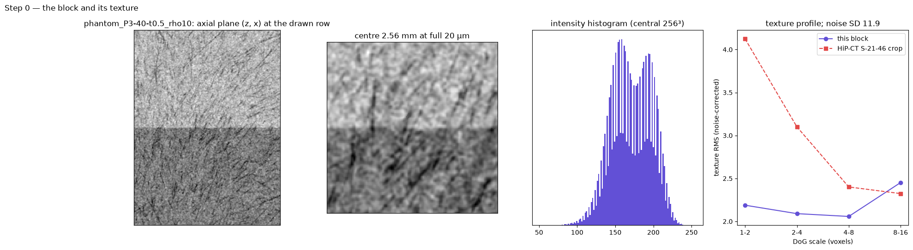

## Step 1 — gradients at σ

*What*: the Gaussian-derivative gradient ∇I at σ (1 voxel), the raw material of everything after. A fibre leaves
its gradients in the plane normal to it; an interface leaves one strong gradient along its normal.

*Look at*: gradient magnitude; gradient direction as colour; a quiver on a small patch.

*Validate*: on a phantom, the angle between the gradient and the true fibre direction should be ~90° in white
matter (the per-site median is reported); the magnitude histogram should show the interface as a separate tail.

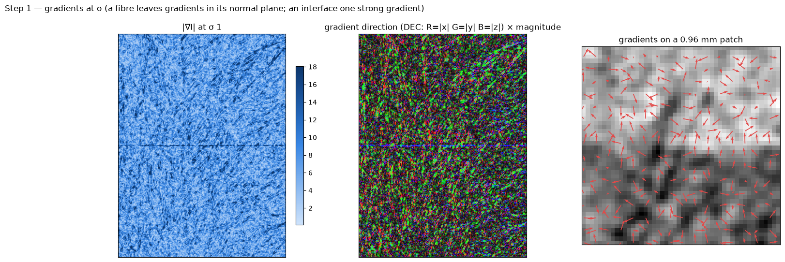

## Step 2 — the interface map and the excision mask

*What*: the gradient magnitude at the coarse scale σ = 3 (`gm`): texture has no energy there, interfaces have all
of it. The excision mask is `gm > 3 × median(gm)`; those voxels' gradients are left out of the tensor integration.

*Look at*: `gm`; the mask over the image; the share excised.

*Validate*: on a phantom, precision–recall of the mask against "within 0.1 mm of a true interface" (the suite's
boundary-detector AUC is this at the site level: 0.85–0.96 at ρ 16); the excised share should be a few per cent
(0.7–3% on the suite's phantoms) — a share above ~10% means the texture itself is being excised.

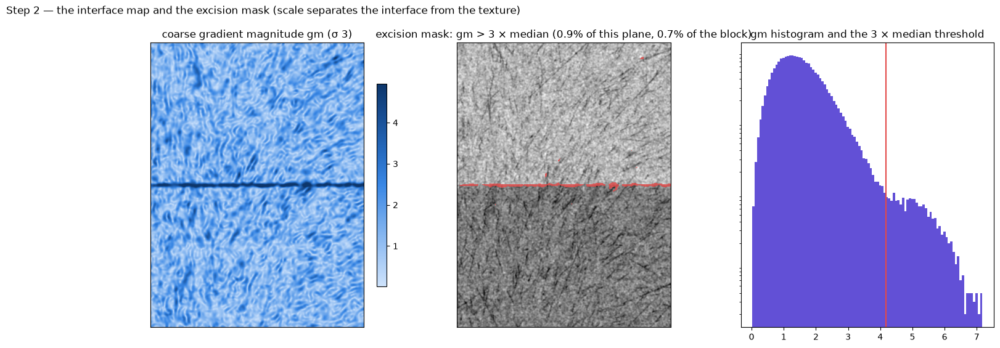

## Step 3 — the structure tensor and the excised tensor

*What*: S = G_ρ ∗ (∇I ∇Iᵀ), and the same with the excised gradients dropped and the integration renormalised.
ρ is the window: 10 voxels = 0.2 mm here.

*Look at*: the six tensor maps are not readable; look at the derived direction-encoded colour (step 4) and at the
angle between the plain and the excised direction — it should be near zero except along interfaces.

*Validate*: on a phantom, the median angle to the truth by distance band (0–0.1, 0.1–0.25, 0.25–0.5, > 2 mm) for
both tensors; the plain tensor fails within 0.1 mm of a step (33° at ρ 10, half texture), the excised one does not
(4.5°, equal to clear tissue). On real data, the angle between the two should be ≤ 1° median and concentrate in
the top decile of `gm`.

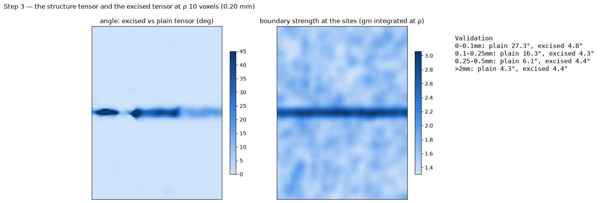

## Step 4 — one direction per site, and its quality

*What*: the eigenvector of the smallest eigenvalue (the fibre direction, axial), the orientation gap
(λ₂ − λ₃) / λ₂ (how well the direction is determined) and Westin's `cl` (how sheet-like the window is).

*Look at*: direction-encoded colour (R = |x|, G = |y|, B = |z|) weighted by the gap; sticks on a slab; the gap and
`cl` maps. Dim colour = undetermined direction; high `cl` = a sheet, where the single direction is not a fibre.

*Validate*: on a phantom, the error by band (the scorecard's "interface fixed", "nothing lost in clear tissue",
"U-fibres kept", "vessels" rows); the gap should be high where the error is low. On real data the gap's median
(0.23–0.26 at ρ 10–16 on both real blocks) says how weakly determined white-matter directions are at this
resolution.

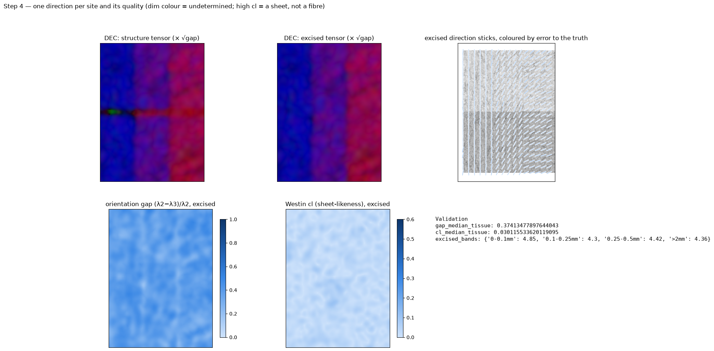

## Step 5 — the gradient-direction ODF

*What*: per site, the distribution of gradient directions on the sphere, weighted by |∇I|², in even real spherical
harmonics to order 8. Its l ≤ 2 part is the structure tensor; the higher orders hold the information the tensor
cannot — two crossing fibres give two rings here and one planar tensor there.

*Look at*: ODF glyphs at a few sites on a slab (the gradient ODF is a ring for one fibre, a point for a sheet); the
order-by-order power.

*Validate*: on the single-fibre phantom the ring width fitted from the ODF is the calibrated response (22.9° at full
texture, 28.9° at half, intensity ODF); on a sheet phantom the ODF is one peak, not a ring.

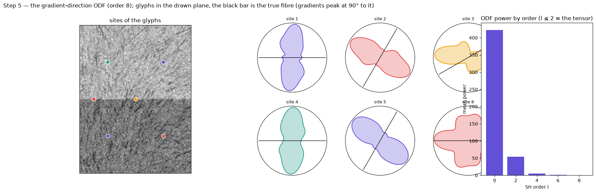

## Step 6 — deconvolution and peaks: the fixels

*What*: constrained spherical deconvolution of the ODF with the single-fibre ring response, then the peaks of the
fibre ODF above a relative threshold and 25° apart: up to three directions with fractions per site. The threshold
is the one that gives ≤ 2% false second populations on dispersed single-fibre texture at the data's texture level
(0.5 at full texture, 0.7 at half for the intensity ODF).

*Look at*: the N-population map (0 / 1 / 2 / 3), fixel sticks on a slab, the fraction of the second population.

*Validate*: on the crossing phantoms, the share of sites with N = 2 and with both directions within 15° (60° at
100% with anatomix48 at ρ 32 and full texture, 68% at ρ 10); on single-fibre phantoms the false-second share; on a
step or gyrus phantom the share of N ≥ 2 by distance from the interface (the sheet-to-ring failure, 30–100% within
0.5 mm before the gate).

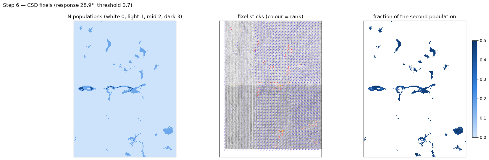

## Step 7 — the interface gate on the fixels

*What*: sites whose coarse gradient exceeds 3× the median report no population — the same scale criterion as the
excision. A contrast sheet deconvolves to a ring of fibre directions, so fixels there are not trusted; the single
direction there is the excised tensor's.

*Look at*: the gated N map; the gated share.

*Validate*: the N ≥ 2 share by band after gating — the 0–0.25 mm bands at a step or gyrus disappear; far from
interfaces the share equals the dispersed-tissue false rate (≤ 2% at the calibrated threshold).

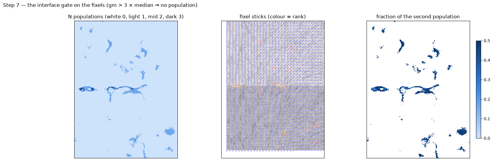

## Step 8 — the shape engine (optional, and a negative result)

*What*: anatomix layer-58 features (48 channels → 8 principal components) as an alternative gradient source: the
summed channel tensor (the "shape tensor"), the channel-resolved tensor and its CP decomposition (TCA), and the
feature ODF.

*Look at*: the feature RGB (PCs 1–3); the shape tensor's DEC beside the structure tensor's; the angle between them.

*Validate*: on a phantom, the TCA error by band (it does not rescue the interface: 44° at the step at ρ 10 against
4.5° for the excision; 7.6° in clear tissue at full texture against 4.6°); the feature ODF's crossing scores (the
one place it wins: 60° at 100% at full texture). On real data the shape tensor sits 25–42° from the structure
tensor with an over-confident gap — read it as a different quantity, not a better fibre direction.

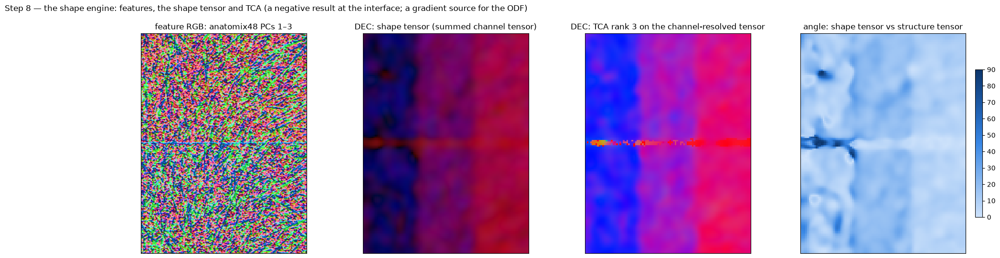

## Step 9 — the field store and a first tractography

*What*: the outputs as the `structure-tensor` package lays them out — `S`, `val`, `vec`, `vec_excised`, `dirs`,
`fracs`, `npop`, `gap`, `cl`, `gm` — and a deterministic streamline pass on the single-vector and the fixel fields
from the same seeds.

*Look at*: streamlines through a slab coloured by direction; the streamline-density map; where the fixel tractogram
departs from the tensor's.

*Validate*: the tracker is checked on synthetic fields (a straight crossing, a circle); between fields, the Dice
and correlation of the density maps and the per-seed divergence say how much the multi-vector field changes the
tracks; a phantom with a known crossing shows whether the fixel tracks pass through it where the tensor tracks
stop or bend.

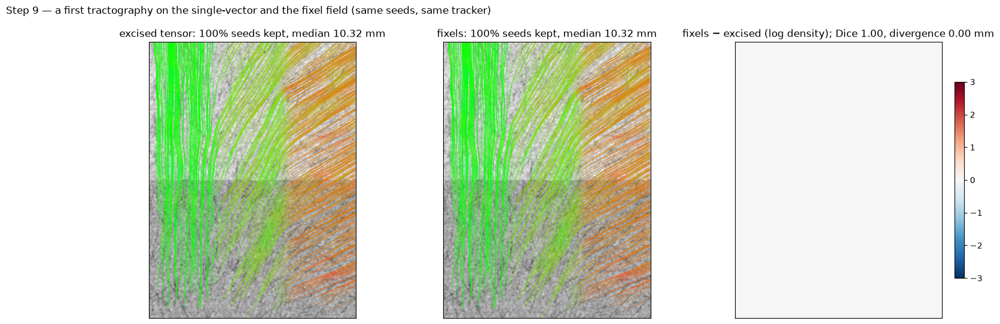

## Step 10 — anisotropic voxels

*What*: the same block area-resampled 2.5× along one axis, read naively and with `spacing`.

*Look at*: the direction-encoded colour of the three; the angle to the isotropic result.

*Validate*: the two regimes of the [non-isotropic data](anisotropy.md) page: with the coarse axis along the fibres
`spacing` is right (5–20°) and the naive tensor is 30–60° off; across the fibres the contrast is lost and every
physical reading snaps onto the coarse axis.

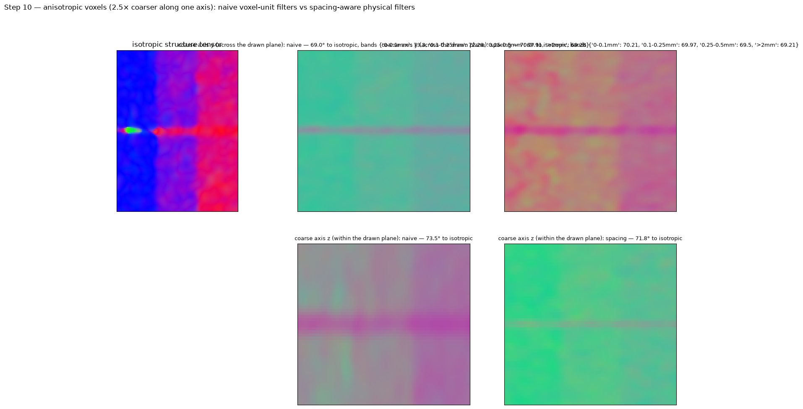
